# Báo cáo Lab01 — Phân loại email spam

Lần chạy tham chiếu `20261119_015148_baseline_tuned`, schema kết quả 2. Bộ dữ liệu và thuật toán giữ nguyên; cấu trúc mới giúp truy nguyên từng lần học, bộ TF-IDF và quyết định chọn ngưỡng. Xem [cấu trúc đầu ra](ResultsLayout.md).

## 1. Xác định bài toán

Phân loại email thành ham (0) và spam (1). Ba thuật toán tự cài là Logistic Regression, Linear SVM và Multinomial Naive Bayes. Macro-F1 validation là tiêu chí chọn, không dùng test để điều chỉnh cấu hình.

## 2. Nguồn dữ liệu và nhãn

Nguồn Data/raw/spam_ham_dataset.csv gồm 5.171 dòng. text là nội dung, label_num là nhãn. email_id lấy từ vị trí dòng gốc để truy nguyên sau làm sạch. Hash nguồn, phiên bản Python/thư viện và cấu hình thực tế được lưu trong run.json.

## 3. Khảo sát dữ liệu

EDA kiểm tra nhãn, dữ liệu thiếu, bản trùng và độ dài văn bản. Không dùng test để lựa chọn đặc trưng dựa trên nhãn test. Hình EDA mô tả toàn bộ nguồn.

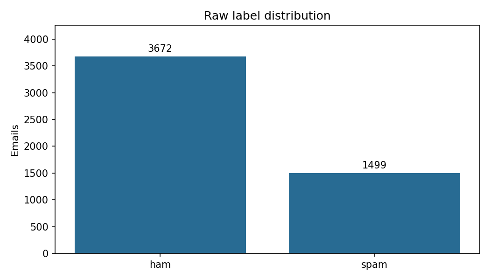

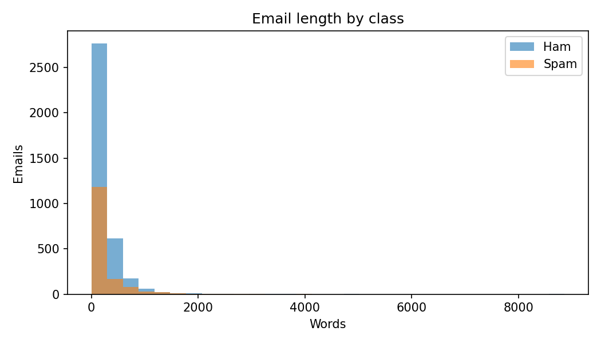

## 4. Làm sạch và loại trùng

Giải mã HTML, loại comment/script/style/thẻ HTML, chuyển chữ thường, thay dấu câu và gạch dưới bằng khoảng trắng, bỏ stop words tiếng Anh. Chỉ giữ nhãn 0/1, nội dung không rỗng. Báo lỗi nếu cùng văn bản sạch có nhãn mâu thuẫn. Loại 287 bản trùng theo văn bản sạch trước chia tập, còn 4.884 email gồm 3.427 ham và 1.457 spam.

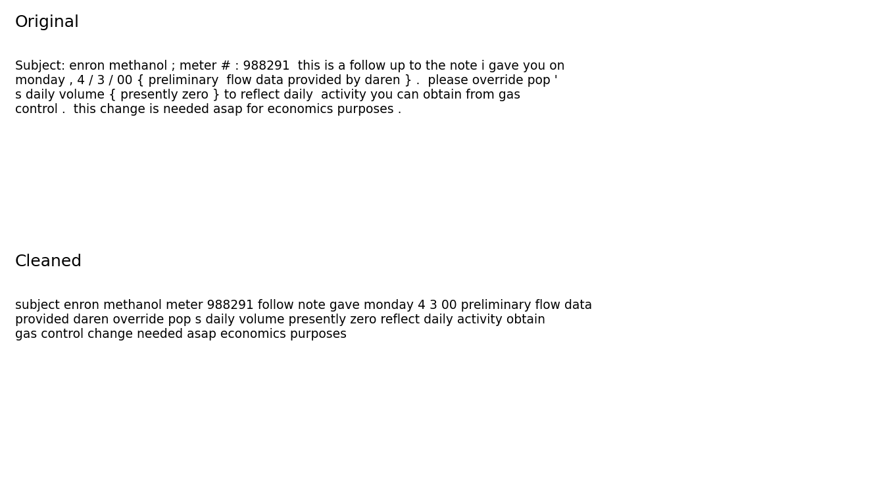

## 5. Chia dữ liệu

Train ban đầu chiếm 80%, test 20%, seed 42, phân tầng theo nhãn. Tách 20% train ban đầu làm validation với seed 43. Subtrain 3.125 email, validation 782 và test 977. Cả ID lẫn văn bản sạch giữa các tập không giao nhau. Train ban đầu được lưu riêng để phân biệt với subtrain.

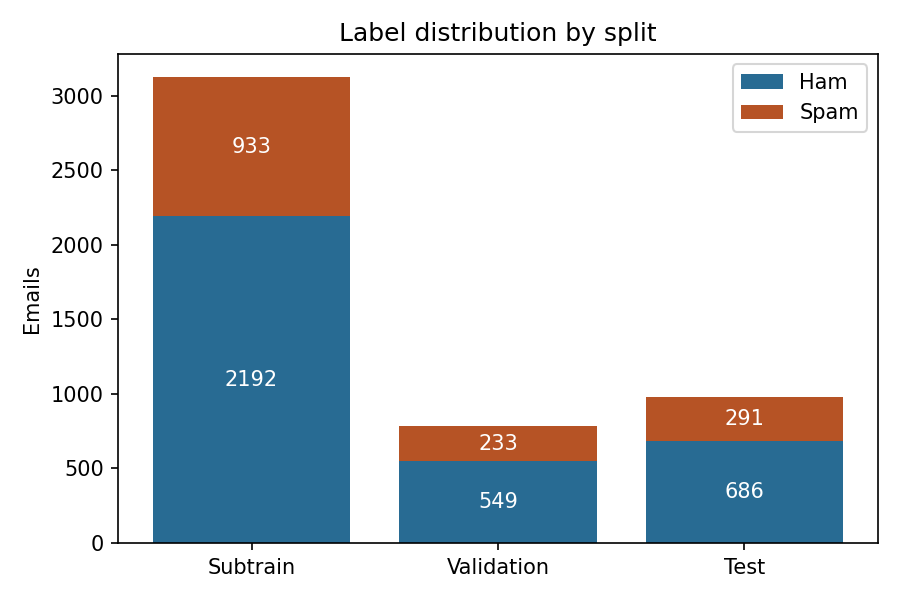

## 6. TF-IDF và đặc trưng

Bộ word unigram/bigram, tối đa 50.000 đặc trưng, chuẩn hóa L2. Chỉ fit trên subtrain, validation/test dùng transform. vectorizer_id ghi nhận dữ liệu dùng fit, cấu hình thực tế và IDF. Ma trận CSR, nhãn và từ vựng lưu trong preprocessing/tfidf/<vectorizer_id>/. Không refit sau chọn ngưỡng.

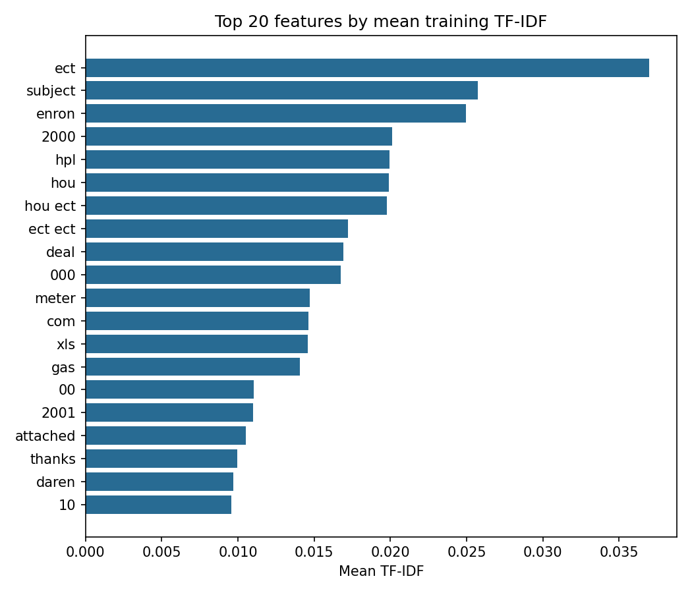

## 7. Mô hình baseline

Huấn luyện cấu hình mặc định trên cùng subtrain và TF-IDF. Logistic ngưỡng 0,5, SVM ngưỡng 0, Naive Bayes alpha=1. Baseline có fit_id riêng và được giữ làm mốc đối chiếu. Dự đoán validation baseline nằm trong tuning/validation/<model>/baseline/.

| fit_id | model | default_threshold | macro_f1 | spam_precision | spam_recall | fp | fn |
| --- | --- | --- | --- | --- | --- | --- | --- |
| fit_0001 | logistic_regression | 0.500000 | 0.412472 | 0.000000 | 0.000000 | 0 | 233 |
| fit_0002 | svm | 0.000000 | 0.412472 | 0.000000 | 0.000000 | 0 | 233 |
| fit_0003 | naive_bayes | nan | 0.933766 | 1.000000 | 0.824034 | 0 | 41 |

## 8. Cài đặt thuật toán

Logistic tính z=Xw+b, sigmoid ra xác suất spam và cập nhật w,b theo gradient cross-entropy trung bình bằng toàn bộ subtrain. Dừng đủ n_iterations, chưa có early stopping.

SVM đổi nhãn sang −1/+1, tối ưu 0,5||w||² + C × trung bình hinge loss có trọng số lớp. Mẫu margin nhỏ hơn 1 đóng góp vào gradient; bias không bị phạt L2. Điểm SVM không phải xác suất.

Naive Bayes tính prior theo tần suất lớp, cộng trọng số TF-IDF theo lớp, làm trơn bằng alpha rồi lưu log xác suất. Dự đoán chọn lớp có log-joint lớn nhất, khi hòa chọn ham. Không có vòng cập nhật gradient hoặc biểu đồ loss giả lập.

## 9. Ghi nhận từng lần huấn luyện

Lần chạy này có 49 lần fit: 3 baseline, 6 Logistic, 35 SVM (7 cấu hình × 5 trọng số lớp), 5 Naive Bayes. training/training_summary.csv ghi tham số thực tế, vectorizer_id, số dòng/cột, thời gian và trạng thái. Mô hình lặp có history.csv chung theo thuật toán và cột fit_id; chỉ vẽ selected_training.png cho cấu hình được chọn; log lấy mẫu khoảng 20 mốc cộng đầu/cuối. Loss Logistic và mục tiêu SVM khác nhau, không so độ lớn để xếp hạng hai thuật toán.

fit_seconds đo fit có kèm chẩn đoán lấy mẫu, không gồm vẽ hình hoặc lưu mô hình; khác cách đo cũ không chẩn đoán. Thời gian toàn pipeline nằm trong run.json. Cấu hình bị loại vẫn giữ thông tin fit nhưng không lưu toàn bộ joblib để tránh phình dữ liệu.

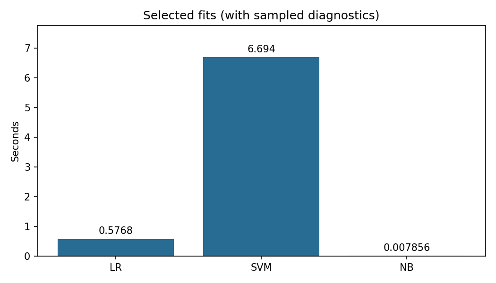

## 10. Tuning và chọn ngưỡng trên validation

Mỗi fit dùng một bộ trọng số cố định để tính điểm validation. Logistic thử ngưỡng từ xác suất; SVM từ điểm quyết định. Khi tự quét, luôn xét ngưỡng mặc định. Khi YAML ép ngưỡng hoặc danh sách riêng, không bảo đảm tốt hơn mặc định. Chọn Macro-F1 cao nhất, hòa điểm ưu tiên ít FP rồi gần ngưỡng mặc định. Giữa các cấu hình SVM hòa điểm, ưu tiên trọng số đều trước số FP và độ gần 0. Logistic/Naive Bayes hòa giữa các cấu hình giữ cấu hình xuất hiện trước.

validation_summary.csv có một dòng mỗi fit, gồm chỉ số mặc định và sau chọn ngưỡng. thresholds.csv có một dòng mỗi ngưỡng của cùng fit_id, selection.json ghi lựa chọn và quy tắc. Thử nhiều ngưỡng không gọi fit lại. Các fit được chọn:

| model | fit_id | parameters | selected_threshold | macro_f1 |
| --- | --- | --- | --- | --- |
| logistic_regression | fit_0008 | {"learning_rate": 5.0, "n_iterations": 1000, "threshold": 0.5} | 0.450945 | 0.995432 |
| svm | fit_0040 | {"C": 100, "class_weight": null, "learning_rate": 0.01, "n_iterations": 3000, "threshold": 0.0} | -0.662012 | 0.983291 |
| naive_bayes | fit_0046 | {"alpha": 0.01} | nan | 0.984754 |

So riêng tác động của ngưỡng trên cùng mô hình:

| model | fit_id | default_threshold | selected_threshold | default_macro_f1 | selected_macro_f1 | FP | FN |
| --- | --- | --- | --- | --- | --- | --- | --- |
| logistic_regression | fit_0008 | 0.500000 | 0.450945 | 0.990807 | 0.995432 | 3 | 0 |
| svm | fit_0040 | 0.000000 | -0.662012 | 0.421603 | 0.983291 | 8 | 3 |

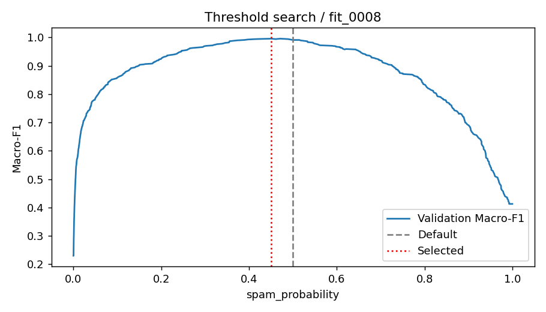

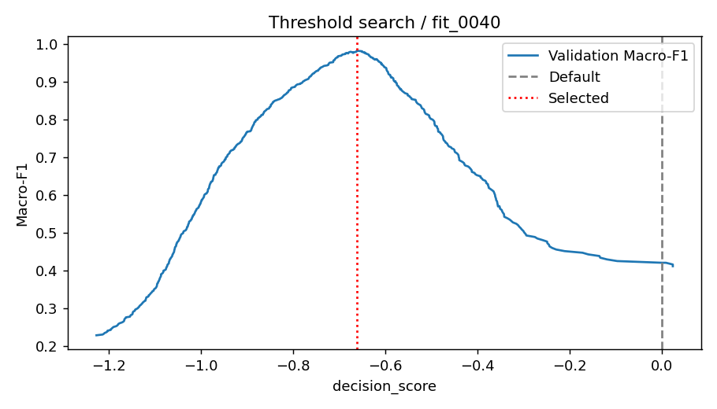

## 11. Đánh giá test

Giữ nguyên mô hình, TF-IDF và ngưỡng đã chọn. Đánh giá sáu trường hợp trên cùng 977 email test; không chia lại test sáu lần. Nhãn thật/dự đoán lập ma trận TN, FP, FN, TP. Precision spam=TP/(TP+FP), Recall spam=TP/(TP+FN), F1 là trung bình điều hòa Precision/Recall; Macro-F1 là trung bình F1 của ham và spam. Accuracy là số dự đoán đúng chia tổng số mẫu.

| model | variant | accuracy | macro_f1 | spam_precision | spam_recall | spam_f1 | spam_as_ham | ham_as_spam |
| --- | --- | --- | --- | --- | --- | --- | --- | --- |
| logistic_regression | baseline | 0.702149 | 0.412508 | 0.000000 | 0.000000 | 0.000000 | 291 | 0 |
| svm | baseline | 0.702149 | 0.412508 | 0.000000 | 0.000000 | 0.000000 | 291 | 0 |
| naive_bayes | baseline | 0.942682 | 0.927334 | 0.995781 | 0.810997 | 0.893939 | 55 | 1 |
| logistic_regression | tuned | 0.991812 | 0.990231 | 0.982935 | 0.989691 | 0.986301 | 3 | 5 |
| svm | tuned | 0.984647 | 0.981807 | 0.960000 | 0.989691 | 0.974619 | 3 | 12 |
| naive_bayes | tuned | 0.982600 | 0.979302 | 0.962838 | 0.979381 | 0.971039 | 6 | 11 |

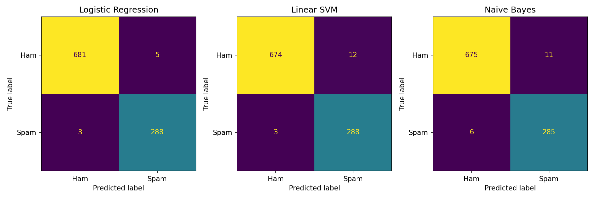

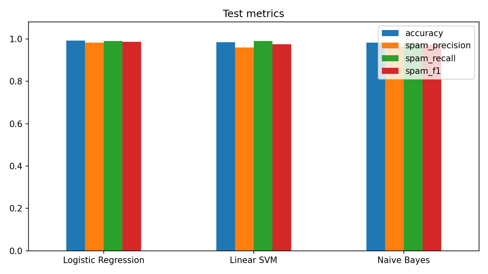

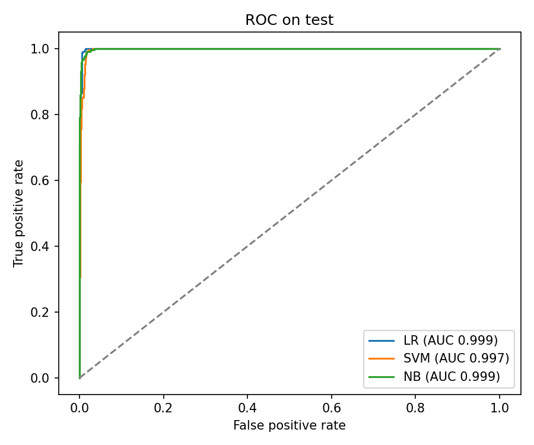

Mỗi evaluation/<model>/<variant>/ có test_metrics.json, classification_report.csv, confusion_matrix.png, predictions.csv và errors.csv. Score Logistic là xác suất, SVM là decision score, Naive Bayes là chênh lệch log-joint. Không gọi tất cả là xác suất.

## 12. Lưu mô hình, tái lập và giới hạn

models/model_info.json liên kết model + variant với fit_id, vectorizer_id và đường dẫn đối tượng. Chỉ baseline và mô hình thắng từng thuật toán được lưu. Dự đoán nạp đúng cặp mô hình và TF-IDF, không học lại. Chạy --model tạo run riêng và không thay bộ mô hình mặc định.

```powershell
python -m Lab01.src.pipeline
python -m Lab01.src.predict --run-id 20261119_015148_baseline_tuned --model svm --text "Claim your free prize now"
```

Notebook đọc và kiểm chứng một run hoàn tất, không ghi đè nó. Báo cáo tạo từ kết quả đã lưu. [Báo cáo PDF](../reports/report_20261119_015148_baseline_tuned.pdf), [bảng test](../results/20261119_015148_baseline_tuned/evaluation/comparison/test_summary.csv), [bảng validation](../results/20261119_015148_baseline_tuned/tuning/validation_summary.csv).

Kết quả cao chỉ mô tả nguồn dữ liệu và lần chia hiện tại, không bảo đảm mọi email thực tế. Dữ liệu có thể thay đổi theo thời gian; cần email mới độc lập để kiểm chứng khi đã xem test qua nhiều vòng. Hạ ngưỡng có thể giảm FN nhưng tăng FP; lựa chọn phải dựa trên validation và mục tiêu sử dụng.
