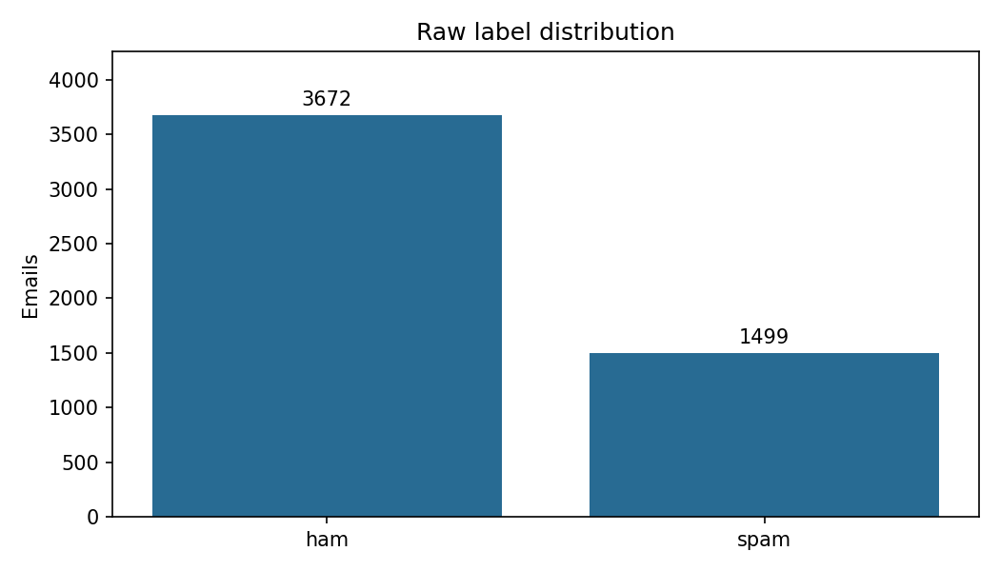
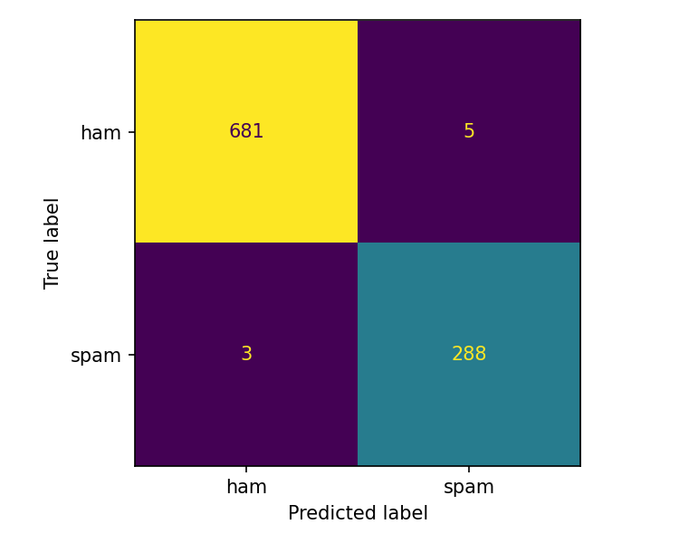
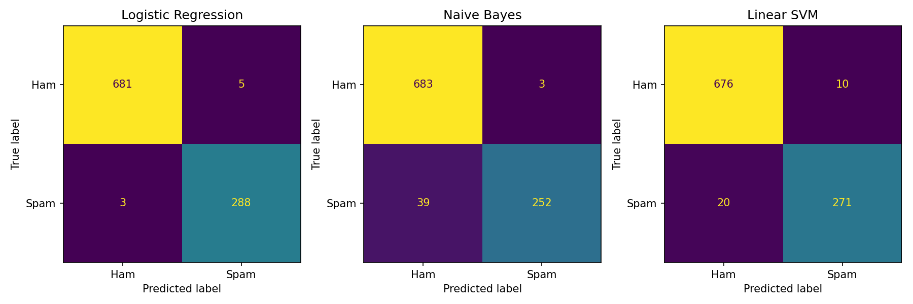
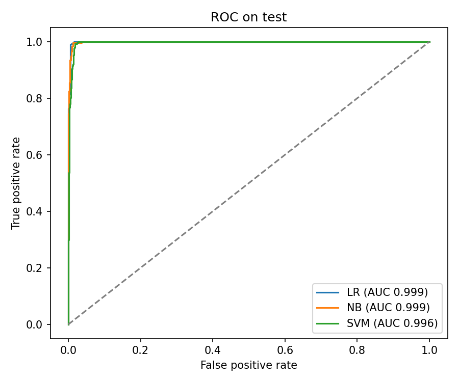

# Lab01 — Mô tả hệ thống phân loại email spam

Số liệu và hình lấy từ lượt chạy `20261106T172203Z-a2e0309c`. Xem [giải thích tham số](ReadmeForParameters.md), [lịch sử thực nghiệm](experiment_logs.csv) và [báo cáo chi tiết](report.md).

## 1. Mục tiêu

Xây dựng hệ thống học có giám sát để phân loại nội dung email thành **ham** (email thường, nhãn 0) hoặc **spam** (email rác, nhãn 1). So sánh Logistic Regression, Multinomial Naive Bayes và Linear SVM trên cùng tập dữ liệu và bộ đặc trưng TF-IDF. Khi nhận email mới, chương trình trả nhãn dự đoán. Logistic Regression trả thêm xác suất spam và SVM trả thêm điểm quyết định cùng ngưỡng.

## 2. Cấu trúc và thành phần

| Tệp trong `src/` | Vai trò |
|---|---|
| [preprocessing.py](../src/preprocessing.py) | Làm sạch, loại trùng, chia dữ liệu và tạo TF-IDF. |
| [eda.py](../src/eda.py) | Thống kê dữ liệu gốc và tạo biểu đồ khám phá. |
| [train.py](../src/train.py) | Chạy baseline, chọn cấu hình trên validation, fit lại và đánh giá mô hình cuối. |
| [evaluate.py](../src/evaluate.py) | Tính chỉ số, ghi dự đoán theo email và xuất ma trận nhầm lẫn. |
| [predict.py](../src/predict.py) | Nạp mô hình và TF-IDF, dự đoán một email mới và ghi lịch sử. |
| [run_report.py](../src/run_report.py) | Tạo mã lượt chạy, nhật ký và hình tiền xử lý. |
| [report.py](../src/report.py) | Xuất bảng, hình và báo cáo Markdown, HTML, PDF từ lượt huấn luyện. |
| [__init__.py](../src/__init__.py) | Đánh dấu package `src`. |

Ba class mô hình nằm trong [algorithms/](../algorithms/). Dữ liệu đầu vào nằm trong `Data/`. `result/runs/<run_id>/` giữ bản lưu thực nghiệm theo lượt, còn `reports/` chứa bảng và hình để đọc hoặc trình bày.

## 3. Dữ liệu

[CSV gốc](../Data/raw/spam_ham_dataset.csv) cung cấp cột `text` và nhãn `label_num`. Pipeline dùng `email_id` để truy vết về dòng gốc.

| Giai đoạn | Ham | Spam | Tổng |
|---|---:|---:|---:|
| Dữ liệu gốc | 3.672 | 1.499 | 5.171 |
| Sau tiền xử lý | 3.427 | 1.457 | 4.884 |

Có 287 dòng trùng theo văn bản sạch bị loại. Dữ liệu gốc có khoảng 29% spam, nên accuracy cần được đọc cùng recall spam, FP và FN.



## 4. Luồng xử lý hệ thống

### 4.1. Làm sạch văn bản

`clean_text()` thực hiện năm thao tác logic. Giải mã thực thể HTML rồi loại thẻ và nội dung script/style. Chuyển chữ thường. Thay dấu câu và dấu gạch dưới bằng khoảng trắng. Bỏ từ dừng tiếng Anh. Ghép token bằng một khoảng trắng. Hai thao tác cuối dùng chung biểu thức tách và ghép từ trong mã.

Ví dụ, `<b>FREE!!!</b> Click now for the prize.` thành `free click prize`. Pipeline bỏ email rỗng, kiểm tra xung đột nhãn và loại trùng theo nội dung sạch trước khi chia tập để hạn chế việc cùng văn bản xuất hiện ở cả train và test.

### 4.2. Chia Train/Test và tạo TF-IDF

| Tập | Ham | Spam | Tổng |
|---|---:|---:|---:|
| Train | 2.741 | 1.166 | 3.907 |
| Test | 686 | 291 | 977 |

Chia phân tầng 80/20 với seed 42. TF-IDF dùng từ đơn và cụm hai từ, tối đa 50.000 cột, chuẩn hóa L2. Khi chạy baseline và fit mô hình cuối, vectorizer chỉ học từ toàn bộ train. Khi chọn tham số, nhóm tách riêng 782 email validation từ train với seed 43 và fit vectorizer trên 3.125 email train con. Validation và test chỉ gọi `transform()` bằng vectorizer của giai đoạn tương ứng.

### 4.3. Các mô hình

| Mô hình | Nguyên lý | Cấu hình cuối |
|---|---|---|
| Logistic Regression | Dùng sigmoid và tối ưu binary cross-entropy bằng gradient descent | Tốc độ học 5, 1.000 vòng, ngưỡng xác suất 0,5 |
| Multinomial Naive Bayes | Tính prior, làm trơn thống kê đặc trưng theo lớp và so điểm log | Alpha = 1 |
| Linear SVM | Tối ưu Hinge Loss và regularization L2, dùng điểm tuyến tính để phân loại | Tốc độ học 0,01, 3.000 vòng, C = 100, trọng số đều, ngưỡng khoảng −0,662 |

## 5. Phương pháp đánh giá

Spam là lớp dương. Hàng của ma trận nhầm lẫn là nhãn thật, cột là nhãn dự đoán, theo thứ tự ham rồi spam.

| Ký hiệu | Ý nghĩa |
|---|---|
| TN | Ham được dự đoán đúng là ham |
| FP | Ham bị gán nhầm là spam |
| FN | Spam bị bỏ lọt thành ham |
| TP | Spam được phát hiện đúng |

| Chỉ số | Cách đọc |
|---|---|
| Accuracy | `(TP + TN) / tổng số email` |
| Precision spam | `TP / (TP + FP)`, tỷ lệ spam thật trong các email được gán spam |
| Recall spam / TPR | `TP / (TP + FN)`, tỷ lệ spam thật được phát hiện |
| F1 spam | Trung bình điều hòa của precision và recall spam |
| Macro F1 | Trung bình F1 của ham và spam, mỗi lớp có trọng số bằng nhau |
| FPR | `FP / (FP + TN)`, tỷ lệ ham bị chặn nhầm |

## 6. Kết quả thực nghiệm

### 6.1. Kết quả trên test

| Mô hình | Accuracy | Precision spam | Recall spam | F1 spam | Macro F1 | FP | FN |
|---|---:|---:|---:|---:|---:|---:|---:|
| Logistic Regression | 99,18% | 98,29% | 98,97% | 98,63% | 99,02% | 5 | 3 |
| Multinomial Naive Bayes | 95,70% | 98,82% | 86,60% | 92,31% | 94,66% | 3 | 39 |
| Linear SVM | 96,93% | 96,44% | 93,13% | 94,76% | 96,29% | 10 | 20 |

### 6.2. Ma trận nhầm lẫn

- Logistic Regression: `[[681, 5], [3, 288]]`.
- Multinomial Naive Bayes: `[[683, 3], [39, 252]]`.
- Linear SVM: `[[676, 10], [20, 271]]`.






### 6.3. Kết quả trên train

Bảng dưới đây được tính lại bằng cách cho ba mô hình cuối đã lưu dự đoán trên **3.907 email chúng đã học**. Đây là số liệu để đối chiếu với test.

| Mô hình | Accuracy | Precision spam | Recall spam | F1 spam | Macro F1 | FP | FN |
|---|---:|---:|---:|---:|---:|---:|---:|
| Logistic Regression | 99,64% | 98,90% | 99,91% | 99,40% | 99,57% | 13 | 1 |
| Multinomial Naive Bayes | 98,95% | 99,30% | 97,17% | 98,22% | 98,74% | 8 | 33 |
| Linear SVM | 98,41% | 96,62% | 98,11% | 97,36% | 98,11% | 40 | 22 |

### 6.4. Tiêu chí tốt nhất

Trên test, Logistic Regression dẫn về accuracy, Macro F1, recall spam, F1 spam và có ít FN nhất. Naive Bayes có precision spam cao nhất, ít FP nhất và thời gian fit ngắn nhất theo [nhật ký huấn luyện](experiment_logs.csv).



ROC sử dụng xác suất của LR, điểm quyết định của SVM và chênh lệch điểm log spam/ham của NB. Các ma trận phía trên thể hiện kết quả tại ngưỡng triển khai.

## 7. Nhận xét và lựa chọn mô hình

- **Logistic Regression** bỏ lọt 3 spam và chặn nhầm 5 ham. Đây là lựa chọn của nhóm khi ưu tiên Macro F1 và phát hiện spam trên lần chia hiện tại.
- **Multinomial Naive Bayes** chặn nhầm ít nhất, 3 ham, nhưng bỏ lọt 39 spam. Mô hình phù hợp để đối chiếu khi ưu tiên giảm FP.
- **Linear SVM** bỏ lọt 20 spam và chặn nhầm 10 ham. Ngưỡng chọn trên validation giúp tăng recall so với ngưỡng 0 trong thực nghiệm trước. Việc chuyển ngưỡng sang mô hình fit lại cần được kiểm chứng thêm.

Chi phí FP và FN phụ thuộc mục tiêu sử dụng. Nếu chặn nhầm email quan trọng gây hậu quả lớn, cần đặt giới hạn FPR trước rồi so recall giữa các cấu hình đáp ứng giới hạn.

## 8. Cách cài đặt và chạy

Chạy các lệnh PowerShell từ thư mục gốc repository.

### 8.1. Tạo môi trường ảo

```powershell
python -m venv .venv
. .\.venv\Scripts\Activate.ps1
```

### 8.2. Cài thư viện

```powershell
python -m pip install -r requirements.txt
```

### 8.3. Chạy pipeline và chạy riêng từng bước

```powershell
python -m Lab01.src.train
```

Lệnh huấn luyện chạy toàn bộ pipeline và xuất báo cáo. CLI hiện không có cờ `--skip-*`. Các lệnh sau cho phép chạy riêng từng bước tiền xử lý. Chạy theo thứ tự nếu chưa có đầu ra trung gian.

```powershell
python -m Lab01.src.preprocessing
python -m Lab01.src.preprocessing --split
python -m Lab01.src.preprocessing --tfidf
```

Để chỉ xuất lại báo cáo từ lượt đã có dữ liệu thời gian fit, chạy `python -m Lab01.src.report --run-id 20261106T172203Z-a2e0309c`.

### 8.4. Dự đoán email mới

```powershell
python -m Lab01.src.predict --model logistic_regression --text "Congratulations! Claim your free cash prize now"
```

Kết quả mẫu là `spam` với xác suất khoảng 0,781. Có thể đổi mô hình thành `naive_bayes` hoặc `svm`.

## 9. Hạn chế và hướng phát triển

1. **Cải thiện SVM.** Xác nhận ngưỡng sau fit lại trên dữ liệu mới. Đo recall và FPR cùng nhau khi thử trọng số lớp hoặc ngưỡng.
2. **Điều chỉnh ngưỡng LR.** Dùng bảng thử ngưỡng trên validation để cân nhắc chi phí FP/FN. Cấu hình triển khai hiện giữ ngưỡng 0,5.
3. **Đồng bộ tiền xử lý.** Dự đoán hiện dùng lại `clean_text()` và vectorizer đã lưu. Có thể bổ sung kiểm tra hồi quy để phát hiện sai khác nếu pipeline thay đổi.
4. **Phân tích lỗi.** Truy vết FP/FN theo `email_id`, ưu tiên email sát ngưỡng và các trường hợp LR/SVM bất đồng.
5. **Đánh giá chéo.** Hiện dùng một lần chia train/test và một validation. Tập test đã được xem nhiều vòng. Chạy Stratified 5-Fold trên train với TF-IDF fit riêng từng fold rồi kiểm chứng trên email mới.
6. **Ghim phiên bản thư viện.** `requirements.txt` hiện dùng khoảng phiên bản. Ghi bộ phiên bản đã kiểm chứng để hỗ trợ tái lập.

## 10. Kết luận

Lab01 hoàn thành luồng từ CSV đến phân loại email mới và xuất báo cáo. Trên tập test hiện tại, **Logistic Regression đạt 99,18% Accuracy và 99,02% Macro F1**, phù hợp nhất với tiêu chí ưu tiên của nhóm. Naive Bayes là mô hình tham chiếu có ít FP nhất. SVM cần được kiểm chứng thêm về độ ổn định của ngưỡng trên dữ liệu mới.
