# Lab01 training report - 20261118_212649_baseline_tuned

Models and TF-IDF fitted on subtrain; configurations and thresholds selected on validation; no refit before test. LR threshold comparison uses saved validation results.

| Model | Accuracy | Macro F1 | Precision | Recall | Spam F1 | FN | FP |
| --- | --- | --- | --- | --- | --- | --- | --- |
| Logistic Regression | 99.18% | 99.02% | 98.29% | 98.97% | 98.63% | 3 | 5 |
| Naive Bayes | 98.26% | 97.93% | 96.28% | 97.94% | 97.10% | 6 | 11 |
| Linear SVM | 98.46% | 98.18% | 96.00% | 98.97% | 97.46% | 3 | 12 |

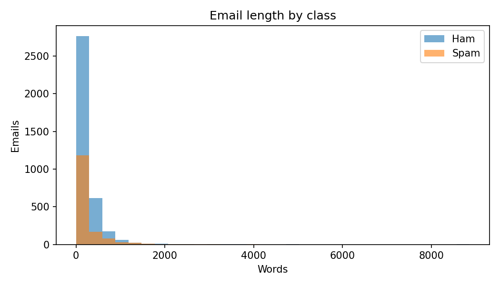

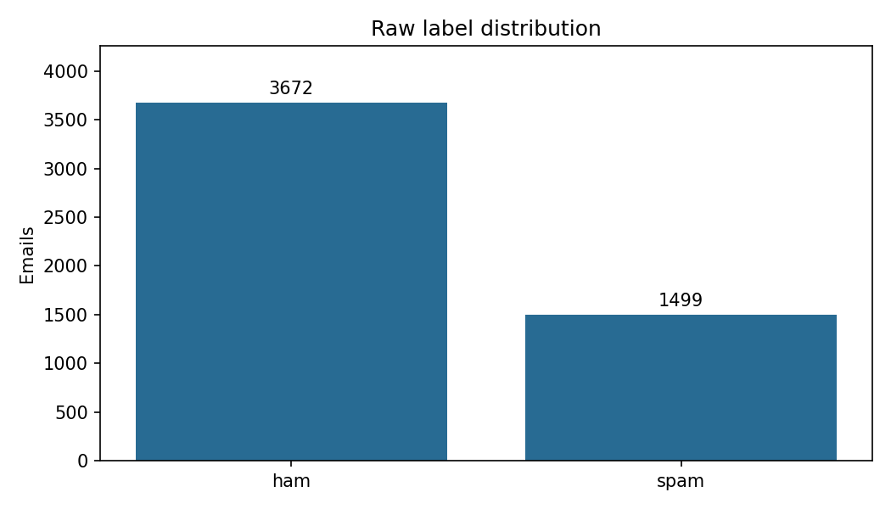

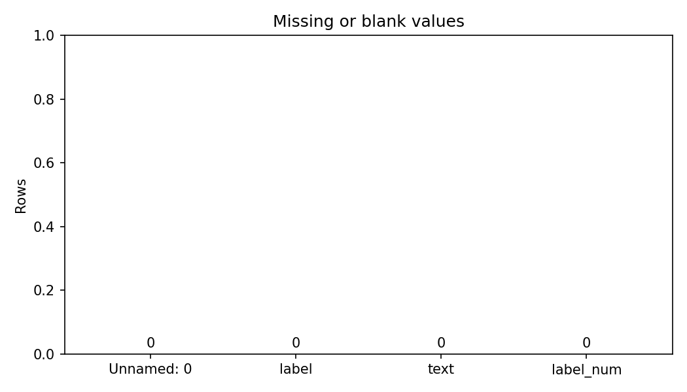

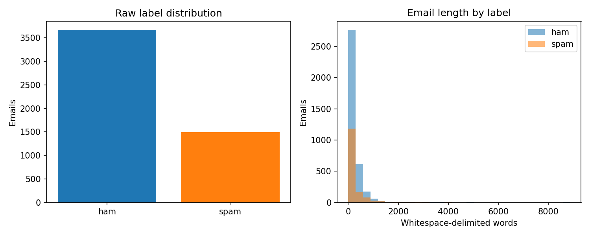

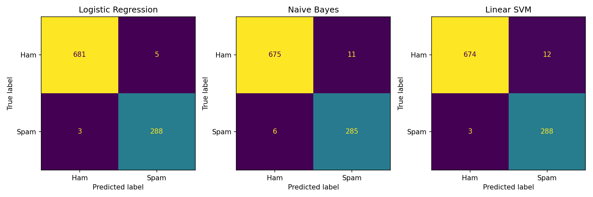

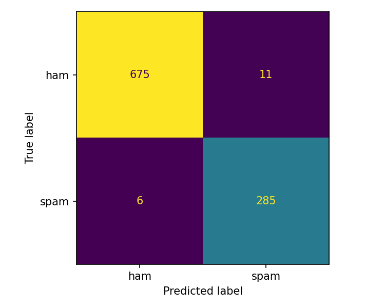

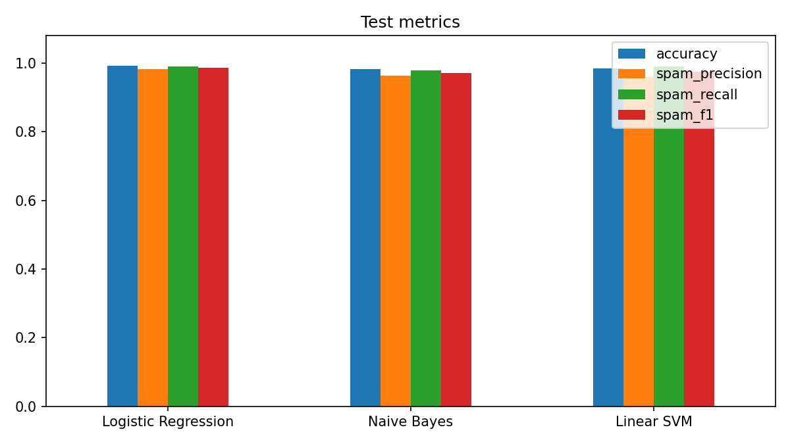

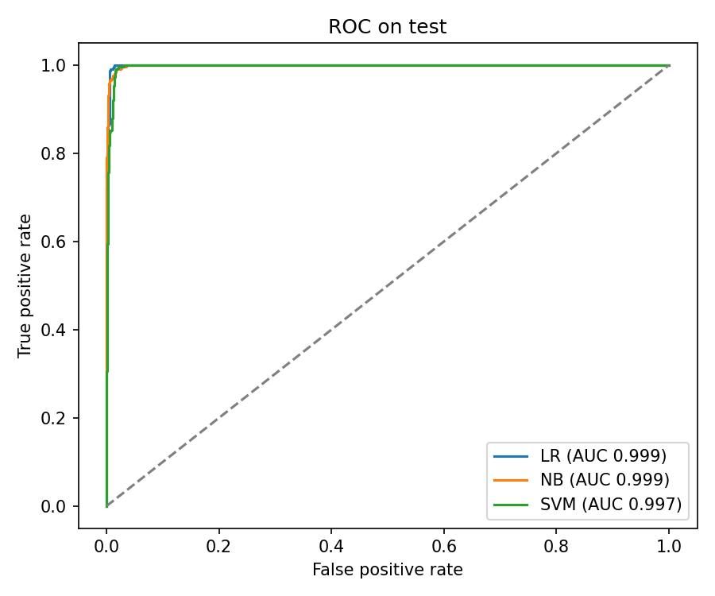

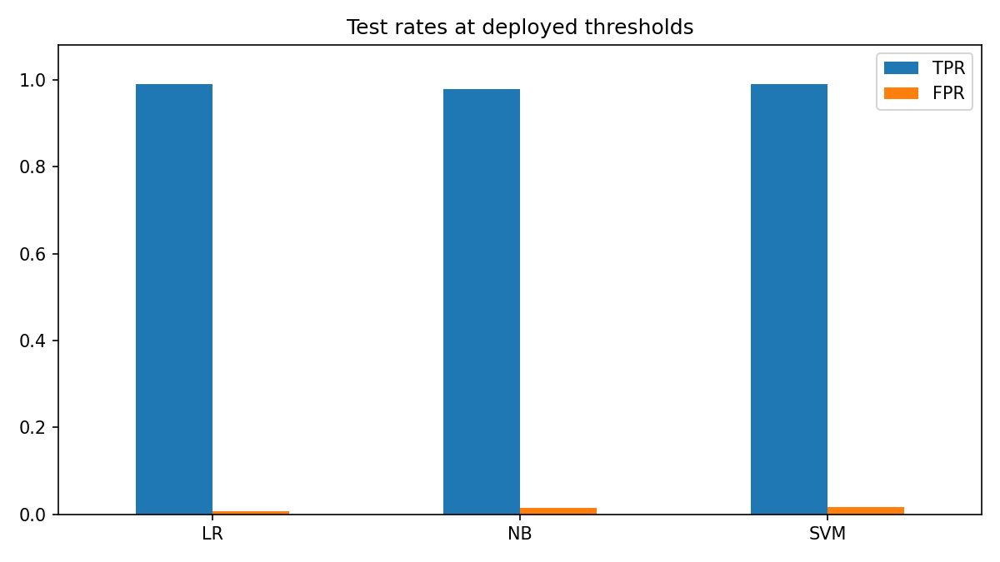

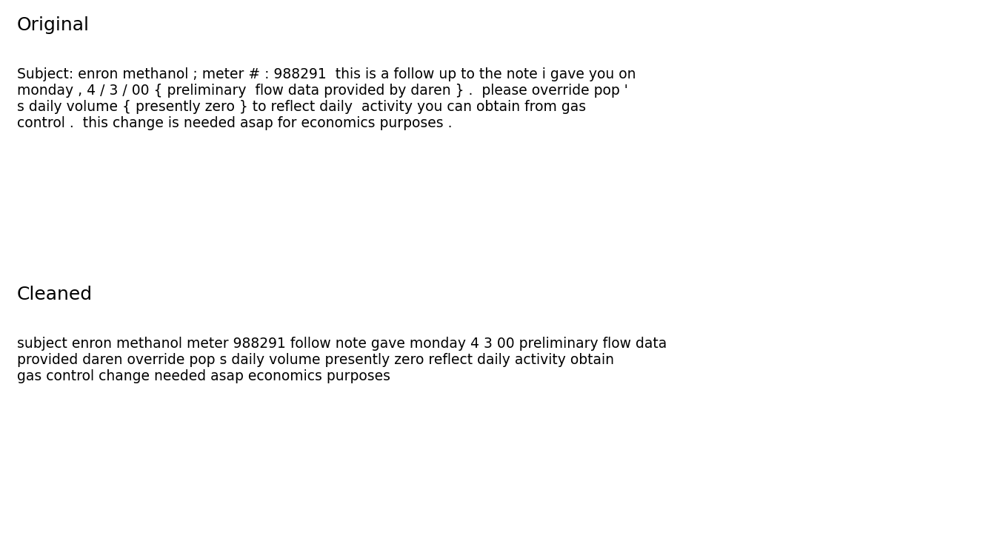

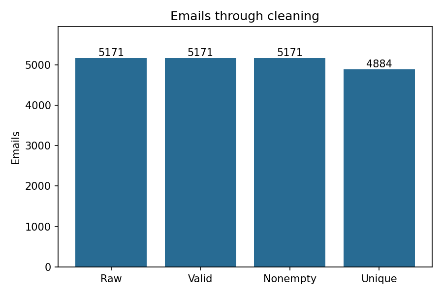

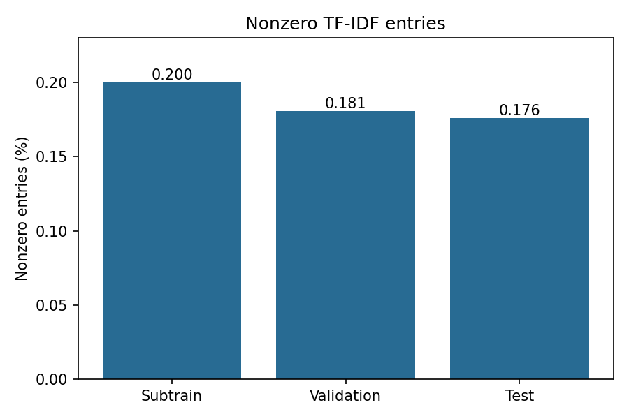

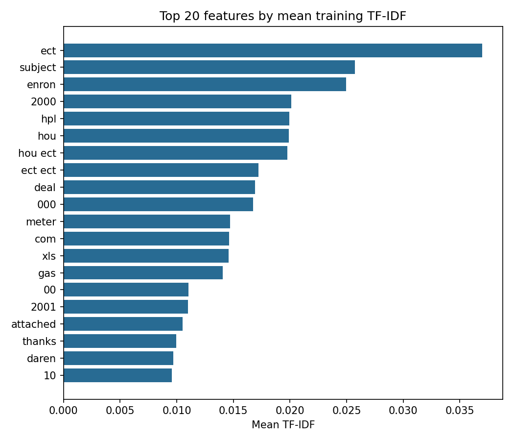

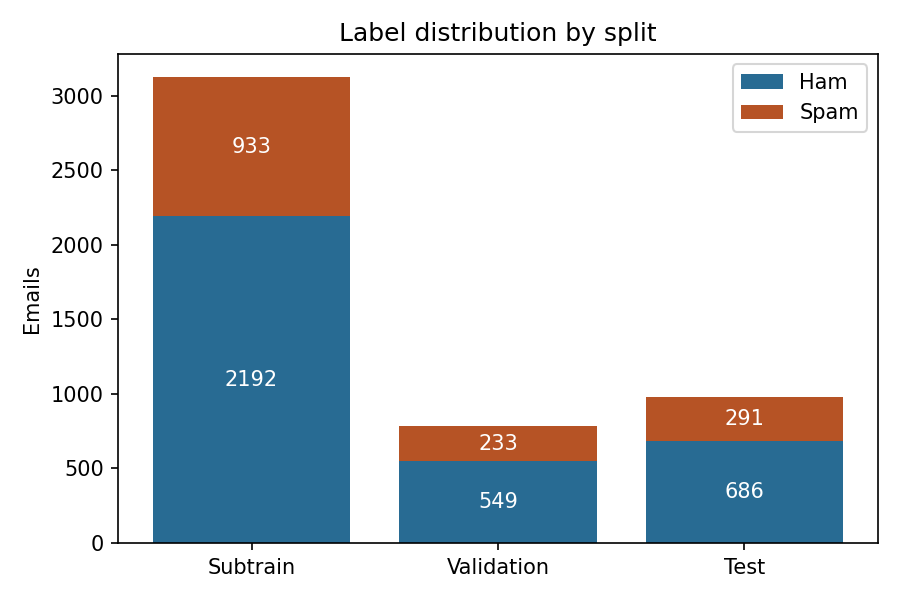

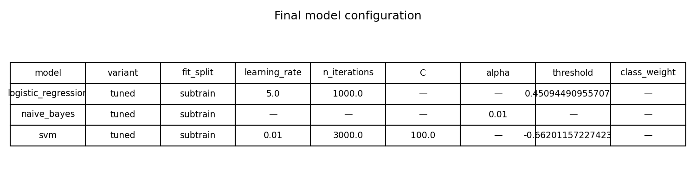

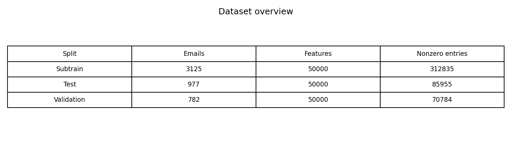

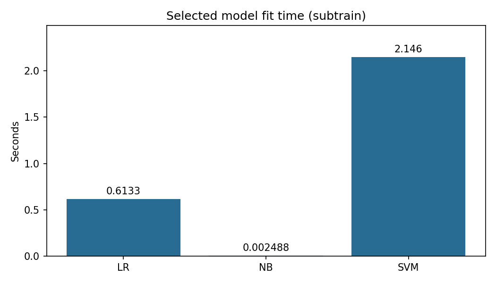
