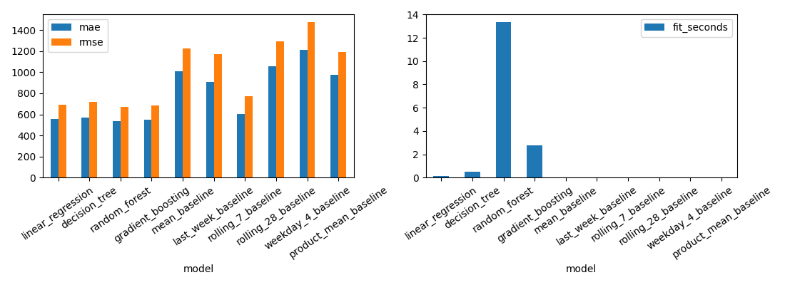

# Lab02 — Dự báo doanh thu sản phẩm FMCG theo tuần

Dùng `data/raw/FMCG_2022_2024.csv` để dự báo Revenue của từng sku trong tuần kế tiếp. Revenue mỗi dòng bằng price_unit × units_sold. Cộng qua tất cả channel, region và pack_type của cùng sku, tuần từ thứ Hai đến Chủ nhật. Đơn vị tiền lấy theo price_unit trong nguồn.

## Thành viên nhóm

- Vũ Thị Thanh Thùy
- Nguyễn Văn Minh
- Lê Hồng Sơn
- Phan Đình Hưng
- Phạm Minh Tiến
- Võ Thị Anh Tú

## Dữ liệu hiện tại

Tệp có 190.757 dòng, 30 SKU, từ 21/01/2022 đến 31/12/2024. Giữ các dòng bán 0 và loại 3 dòng units_sold âm khỏi mục tiêu doanh thu gộp. Còn 190.754 dòng hợp lệ. Chọn 20 SKU theo Revenue train, có doanh thu dương ở ít nhất 6 tuần train. Chỉ giữ tuần đầy đủ. Tuần thiếu giao dịch được quy ước Revenue bằng 0.

| Tập | Thời gian, bao gồm Chủ nhật cuối tuần | Mẫu |
|---|---|---:|
| Train | 08/08/2022–22/10/2023 | 1.260 |
| Validation | 23/10/2023–26/05/2024 | 620 |
| Test | 27/05/2024–29/12/2024 | 620 |

Các mốc 60/20/20 được xác định trước khi bỏ 28 tuần đầu thiếu lịch sử. Mô hình chỉ dùng lịch sử trước tuần dự báo cùng thông tin lịch đã biết. Giá, khuyến mãi, tồn kho, giao hàng và số lượng bán của tuần tương lai không được đưa vào đầu vào.

## Chạy riêng theo nhiệm vụ

Chạy từng bước từ thư mục gốc. Lệnh chuẩn bị tạo run_id mới và in ra `Prepared run`. Dùng đúng mã đó cho các bước sau:

```powershell
python -m Lab02.src.preprocessing
$runId = "MÃ_LƯỢT_VỪA_TẠO"

python -m Lab02.src.tuning --run-id $runId
python -m Lab02.src.train --run-id $runId
python -m Lab02.src.evaluate --run-id $runId

python -m Lab02.src.predict --run-id $runId --history Lab02/data/preprocessing/test.csv --product YO-029 --date 2024-12-30
```

| Module | Nhiệm vụ | Trạng thái sau bước |
|---|---|---|
| preprocessing | Tạo lượt, chụp cấu hình, tổng hợp và chia dữ liệu | prepared |
| tuning | Thử bộ đặc trưng và siêu tham số trên train/validation | tuned |
| train | Fit cấu hình đã chọn trên train + validation, lưu bốn mô hình và bộ xử lý | trained |
| evaluate | Nạp mô hình, chấm test, tạo báo cáo và cập nhật bản demo mặc định | success |
| predict | Nạp một mô hình của run_id và dự đoán bằng đặc trưng đã chốt | Không huấn luyện |

Muốn đánh giá lại chỉ chạy evaluate với run_id đã huấn luyện. Muốn demo chỉ chạy predict. Hai lệnh này không gọi tuning hoặc fit.

Tuning và train đã hoàn tất không được ghi đè trong cùng lượt. Muốn thay cấu hình, tạo lượt mới bằng preprocessing. Lượt lỗi có thể chạy lại bước chưa hoàn tất. Mỗi lượt có khóa trong khi một bước đang chạy, ngăn hai bước sửa cùng kết quả.

`python -m Lab02.src.pipeline` gọi lần lượt prepare_run → tune_run → train_run → evaluate_run. Có thể dùng `--config đường_dẫn.yaml` với preprocessing hoặc pipeline. Những bước sau đọc config.yaml đã chụp trong lượt đó.

models/selection.json trỏ tới lượt đã đánh giá thành công mới nhất. Nếu bỏ --run-id khi dự đoán, chương trình dùng lượt này. Nếu truyền --run-id, mô hình và bộ xử lý đều lấy trong results/runs/<run_id>/models. CSV data/preprocessing được cập nhật sau bước evaluate thành công.

## Chạy thực nghiệm

Chạy từ thư mục gốc repository:

```powershell
python -m pip install -r requirements.txt
python -m Lab02.src.pipeline
```

Pipeline tạo dữ liệu tuần, khảo sát, thử basic/trend/robust với bốn thuật toán tự cài, chọn cấu hình theo RMSE trung bình ba cửa sổ mở rộng và validation cuối, fit lại trên train + validation rồi đánh giá test. Mỗi lượt có thư mục riêng. models/ và data/preprocessing/ là bản của lượt thành công mới nhất.

## Kết quả tham chiếu

Lượt `2026-11-24_13-01-41`. Gradient Boosting được chọn bằng validation, Random Forest có điểm test tốt nhất. Điểm test dùng để mô tả chất lượng sau lựa chọn.

| Mô hình | MAE | RMSE | R² |
|---|---:|---:|---:|
| linear_regression | 553.3854 | 692.4685 | 0.6704 |
| decision_tree | 571.7894 | 721.2805 | 0.6424 |
| random_forest | 532.7812 | 671.2279 | 0.6903 |
| gradient_boosting | 546.2439 | 686.1757 | 0.6763 |
| mean_baseline | 1005.8798 | 1227.8928 | -0.0364 |
| last_week_baseline | 910.3548 | 1172.0392 | 0.0557 |
| rolling_7_baseline | 606.0890 | 771.6073 | 0.5907 |
| rolling_28_baseline | 1057.0406 | 1288.8630 | -0.1419 |
| weekday_4_baseline | 1208.4414 | 1476.5895 | -0.4987 |
| product_mean_baseline | 973.9377 | 1191.3819 | 0.0243 |



## Cấu trúc

```text
Lab02/
├── algorithms/          Ridge, Decision Tree, Random Forest, Gradient Boosting
├── data/
│   ├── raw/FMCG_2022_2024.csv
│   └── preprocessing/   train.csv, validation.csv, test.csv, summary.json
├── src/                 Tiền xử lý, tuning, train, đánh giá, dự đoán và báo cáo
├── models/              Bốn mô hình demo, danh mục SKU, lựa chọn bằng validation
├── results/runs/        Dữ liệu, tuning, mô hình và kết quả riêng từng lượt
├── reports/             Markdown, HTML, PDF và ảnh theo lượt
├── docs/                Phương pháp, tham số, hình minh họa
└── notebooks/           Notebook đọc và kiểm tra lượt tham chiếu
```

CSV tiền xử lý và CSV đánh giá của FMCG dùng sku, date, Revenue. Bên trong mô hình, StockCode và sales là ánh xạ tương ứng để tái sử dụng thuật toán. Các đặc trưng lag_7, mean_28 và zero_days_28 có đơn vị tuần trong cấu hình này. Đọc bảng đầy đủ trong tài liệu tham số.

## Dự đoán từ lịch sử tuần

```powershell
python -m Lab02.src.predict --run-id 2026-11-24_13-01-41 --history Lab02/data/preprocessing/test.csv --product YO-029 --date 2024-12-30
```

CSV cần sku,date,Revenue, đủ 28 tuần liên tiếp trước tuần dự báo của SKU đã được huấn luyện. date là thứ Hai. Dòng từ tuần dự báo trở đi được bỏ qua. Có thể thêm --model random_forest. Đầu ra predicted_revenue được ghi cùng run_id vào reports/weekly_revenue_inference_history.csv.

Đây là dự báo một bước với lịch sử thực tế đã biết. Khi dự báo nhiều tuần liên tiếp, cần quy trình tạo lịch sử cho các tuần chưa quan sát.

## Tài liệu và kết quả

- [Báo cáo chi tiết](docs/Lab02_Report.md)
- [Giải thích tham số và đặc trưng](docs/parameters.md)
- [Notebook thực nghiệm](notebooks/Lab02_Product_Sales_Prediction.ipynb)
- [Báo cáo lượt tham chiếu](reports/archive/report_2026-11-24_13-01-41.md)
- [Báo cáo PDF](reports/archive/report_2026-11-24_13-01-41.pdf)
- [Chỉ số test](results/runs/2026-11-24_13-01-41/evaluation/metrics.csv)
