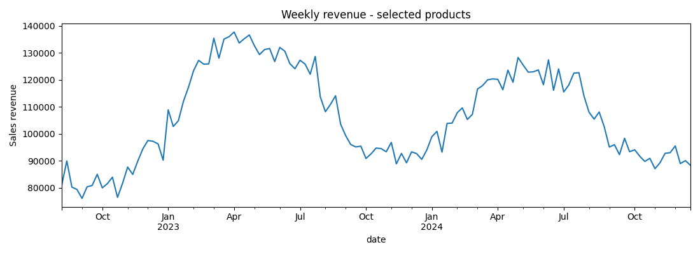
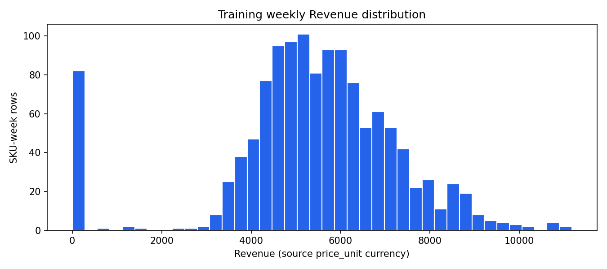
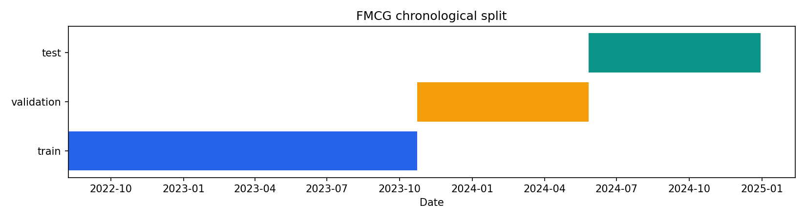
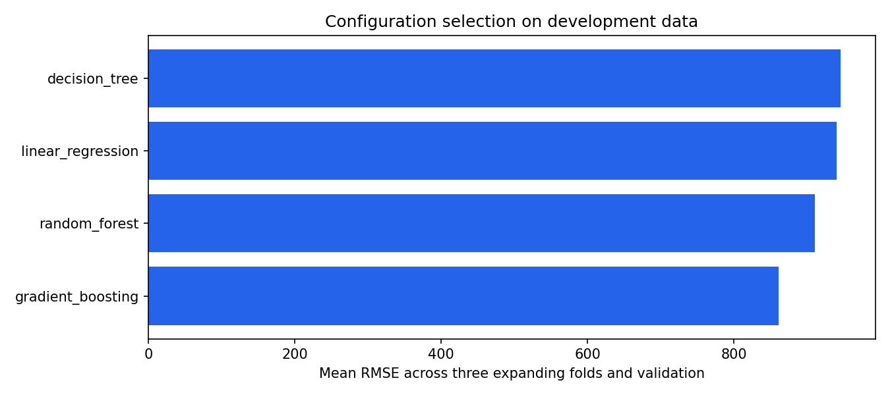
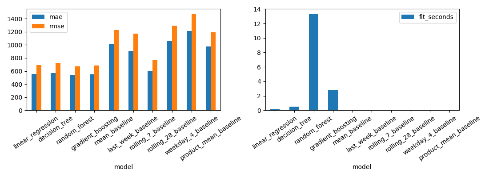
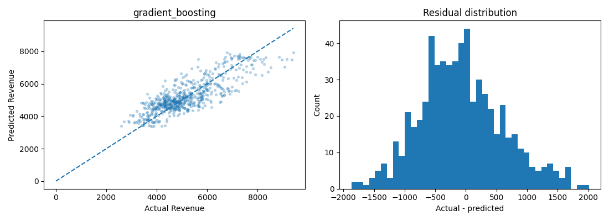
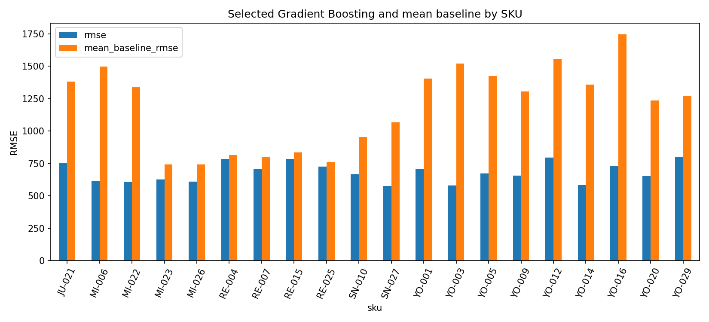

# Báo cáo Lab02 — Dự báo doanh thu sản phẩm FMCG theo tuần

## 1. Mục tiêu

Dự đoán Revenue của một SKU trong tuần kế tiếp bằng lịch sử doanh thu và thông tin lịch. Revenue mỗi dòng bằng price_unit × units_sold. Tổng hợp theo sku × tuần qua các kênh, khu vực và loại đóng gói. Lượt tham chiếu `2026-11-24_13-01-41` có trạng thái success.

## 2. Nguồn dữ liệu và làm sạch

Nguồn [FMCG_2022_2024.csv](../data/raw/FMCG_2022_2024.csv), UTF-8, 190.757 dòng và 14 cột, 30 SKU, từ 21/01/2022 đến 31/12/2024. Không có ô thiếu hoặc dòng trùng trong lượt kiểm tra. Loại 3 dòng units_sold âm khỏi doanh thu gộp, giữ 3.862 dòng bán 0. Có 190.754 dòng hợp lệ.

| Cột nguồn | Cách sử dụng |
|---|---|
| date, sku | Tạo tuần và xác định sản phẩm |
| price_unit, units_sold | Tính Revenue lịch sử |
| channel, region, pack_type | Cộng gộp tất cả giá trị trong cùng SKU/tuần |
| brand, segment, category | Có trong nguồn, chưa dùng làm đặc trưng mô hình hiện tại |
| promotion_flag | Chưa đưa vào dự báo, chưa có kế hoạch khuyến mãi tương lai |
| delivery_days, stock_available, delivered_qty | Chưa dùng làm đầu vào dự báo |

Không suy đoán đơn vị tiền tệ từ tên vùng. Giá được dùng đúng như nguồn, chưa áp thêm hệ số giảm giá từ promotion_flag. Giá trị âm có thể mang ý nghĩa trả hàng, nhưng mục tiêu được chốt là doanh thu gộp, nên ba dòng này bị loại và được ghi trong summary.

## 3. Tổng hợp và phạm vi sản phẩm

Tuần từ thứ Hai đến Chủ nhật. Loại hai tuần biên không đủ bảy ngày theo phạm vi ngày của dữ liệu. Chọn tối đa 20 SKU theo doanh thu train, chỉ xét SKU có doanh thu dương trong ít nhất 6 tuần train. Tạo lưới SKU/tuần và điền Revenue=0 khi không có bản ghi. Giả định này chưa phân biệt thiếu giao dịch với thiếu quan sát.





## 4. Chia dữ liệu theo thời gian

| Tập | Bắt đầu | Kết thúc, bao gồm Chủ nhật | Mẫu |
|---|---|---|---:|
| Train | 08/08/2022 | 22/10/2023 | 1.260 |
| Validation | 23/10/2023 | 26/05/2024 | 620 |
| Test | 27/05/2024 | 29/12/2024 | 620 |

Mốc thời gian dùng tỷ lệ 60/20/20 trước khi bỏ 28 tuần đầu thiếu lịch sử. Mọi SKU trong cùng tuần thuộc cùng tập. Các fold mở rộng dùng danh mục đã chọn từ train tổng, nên phạm vi kiểm chứng là danh mục cố định. Bộ xử lý số và từ vựng SKU chỉ fit trên phần train của từng lần thử.



## 5. Đặc trưng và phòng tránh rò rỉ dữ liệu

basic dùng SKU, lag_1, lag_7, mean_7, mean_28 và lịch của ngày thứ Hai. trend bổ sung chênh lệch trung bình 7/28 tuần, lag_1 với mean_7 và lag_1 với lag_7. robust bổ sung trung vị, độ lệch chuẩn, số tuần doanh thu 0 và các mốc lịch sử.

Tên cột được kế thừa trong mã. lag_7 nghĩa là 7 tuần trước. mean_28 là trung bình 28 tuần trước. same_weekday_mean_4 lấy trung bình tại 7,14,21,28 tuần trước. weekday bằng 0 và is_weekend bằng 0 vì mọi hàng đều là thứ Hai. Hai cột lịch hằng này không mang thông tin phân biệt tuần.

Các thống kê dùng shift(1) hoặc các độ trễ dương để loại Revenue tuần đang dự báo. Giá, khuyến mãi, tồn kho và giao hàng cùng tuần tương lai chưa được dùng. Mỗi mẫu test được dự báo với Revenue thực tế của các tuần trước, bao gồm tuần trước nằm trong test. Đây là đánh giá rolling một bước.

## 6. Cấu trúc và nguyên lý thuật toán

```text
pipeline.main()
├── preprocessing.prepare_run() → lượt mới, tổng hợp tuần, chia dữ liệu
├── tuning.tune_run() → chọn cấu hình bằng dữ liệu phát triển
│   └── tune() → train_model() cho từng ứng viên
├── train.train_run() → fit lại cấu hình đã chọn và lưu mô hình
└── evaluate.evaluate_run() → nạp mô hình, chấm test và xuất báo cáo

predict.main() → nạp mô hình theo run_id → lịch sử 28 tuần → predict()
```

Ridge học hệ số với regularization. Decision Tree chia đặc trưng để giảm tổng sai số bình phương. Random Forest trung bình nhiều cây bootstrap. Gradient Boosting xây cây nối tiếp để học phần dư. Cả bốn thuật toán tự cài NumPy, được ghép với bộ điền thiếu, chuẩn hóa và mã hóa SKU.

## 7. Chọn cấu hình

Mỗi ứng viên được chấm ở ba cửa sổ train mở rộng và validation cuối. selection_rmse là trung bình RMSE của bốn giai đoạn. Chọn cấu hình tốt nhất trong từng họ thuật toán và chọn mô hình demo bằng cùng tiêu chí.



Lựa chọn cuối gồm Ridge alpha=10, 3.000 vòng, bộ robust; Decision Tree độ sâu 10, ít nhất 20 mẫu/lá, bộ trend; Random Forest 80 cây, độ sâu 14, ít nhất 10 mẫu/lá, bộ robust; Gradient Boosting 100 cây, độ sâu 2, learning rate=0,05, bộ trend. [Cấu hình được chọn](../results/runs/2026-11-24_13-01-41/tuning/selection.json).

## 8. Kết quả test

| Mô hình | MAE | RMSE | R² |
|---|---:|---:|---:|
| linear_regression | 553.3854 | 692.4685 | 0.6704 |
| decision_tree | 571.7894 | 721.2805 | 0.6424 |
| random_forest | 532.7812 | 671.2279 | 0.6903 |
| gradient_boosting | 546.2439 | 686.1757 | 0.6763 |
| mean_baseline | 1005.8798 | 1227.8928 | -0.0364 |
| last_week_baseline | 910.3548 | 1172.0392 | 0.0557 |
| rolling_7_baseline | 606.0890 | 771.6073 | 0.5907 |
| rolling_28_baseline | 1057.0406 | 1288.8630 | -0.1419 |
| weekday_4_baseline | 1208.4414 | 1476.5895 | -0.4987 |
| product_mean_baseline | 973.9377 | 1191.3819 | 0.0243 |

Random Forest có RMSE test thấp nhất, 671,2279 và R² 0,6903. Gradient Boosting được chọn từ validation và là mô hình demo, với RMSE test 686,1757, MAE 546,2439 và R² 0,6763. Giảm RMSE khoảng 44,12% so với mean baseline. Điểm test dùng mô tả chất lượng sau lựa chọn.

MAE và RMSE cùng đơn vị doanh thu nguồn, càng thấp càng tốt. MSE có đơn vị bình phương. R² đo mức giảm sai số bình phương so với trung bình target test và có thể âm. Bảng chỉ số đầy đủ được lưu trong [metrics.csv](../results/runs/2026-11-24_13-01-41/evaluation/metrics.csv).



## 9. Phân tích sai số

Phần dư bằng Revenue thực tế trừ dự đoán. Dương là dự báo thiếu, âm là dự báo dư. Hình trái so sánh thực tế và dự đoán, hình phải mô tả phân phối phần dư.






Các bảng *_sku_metrics.csv phân tích từng SKU. *_largest_errors.csv chứa mười lỗi lớn nhất. Các bảng theo weekday chỉ có thứ Hai nên chưa cung cấp phân tích ngày trong tuần.

## 10. Tái lập và dự đoán

[Cấu hình thực nghiệm](../results/runs/2026-11-24_13-01-41/config.yaml), run.json và summary.json ghi nguồn dữ liệu, hash, phạm vi và mốc chia. models/ là bản dùng demo, còn mô hình tham chiếu nằm riêng trong results/runs.

```powershell
python -m Lab02.src.pipeline
python -m Lab02.src.predict --history Lab02/data/preprocessing/test.csv --product YO-029 --date 2024-12-30
```

CSV lịch sử dùng sku,date,Revenue với 28 tuần liên tiếp trước ngày dự báo. date là thứ Hai. predicted_revenue có đơn vị tiền của price_unit nguồn.

## 11. Giới hạn

Kết quả áp dụng cho 20 SKU, một seed và một cách chia. Chưa đánh giá SKU mới hoặc thay đổi danh mục theo từng cửa sổ. Chưa có kế hoạch giá và khuyến mãi tương lai. Quy ước tuần không có bản ghi bằng 0 cần được xác nhận khi triển khai. Nếu dùng dữ liệu mới hoặc thay đặc trưng, cần chọn lại bằng validation và đánh giá trên giai đoạn độc lập.

## 12. Nguồn tài liệu và hình

- [Hướng dẫn chạy](../README.md)
- [Tham số và đặc trưng](parameters.md)
- [Báo cáo tự động](../results/runs/2026-11-24_13-01-41/report.md)
- [Nguồn ảnh và mã băm](images/image_manifest.json)

Ảnh được đồng bộ hoặc dựng từ CSV của cùng lượt FMCG. Số liệu được giữ nguyên từ thực nghiệm tham chiếu.

## Chạy riêng từng nhiệm vụ

Các lệnh preprocessing, tuning, train, evaluate và predict đã có điểm vào riêng. Dùng cùng --run-id từ sau bước chuẩn bị. Xem [bảng lệnh](../README.md). evaluate chỉ nạp mô hình đã lưu, không gọi fit hoặc tuning. predict cố định bộ xử lý và thuật toán theo run_id.
