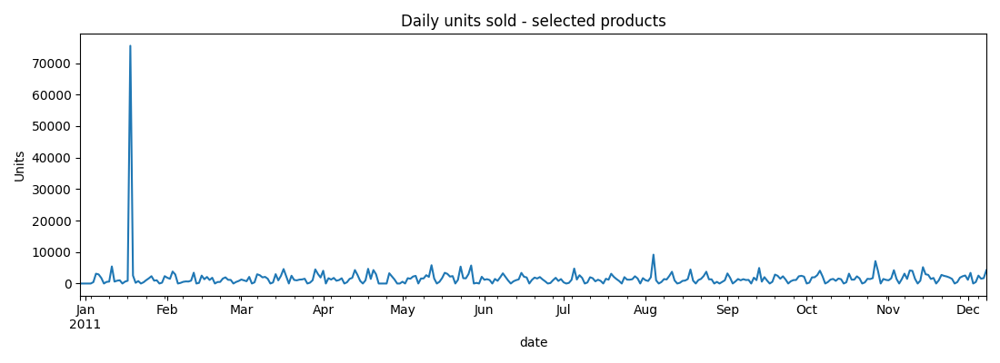
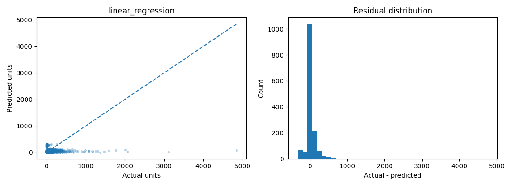
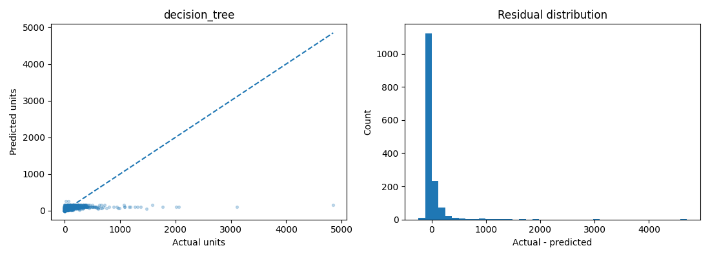
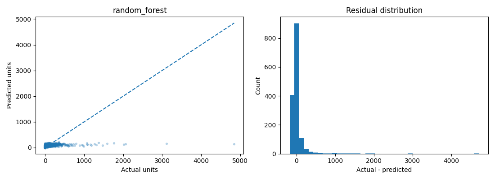
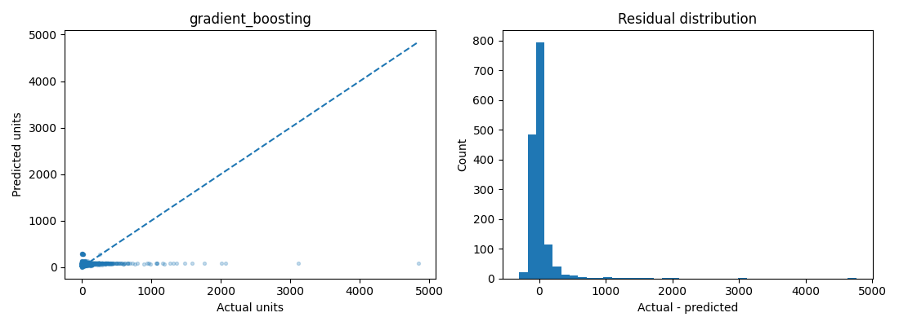
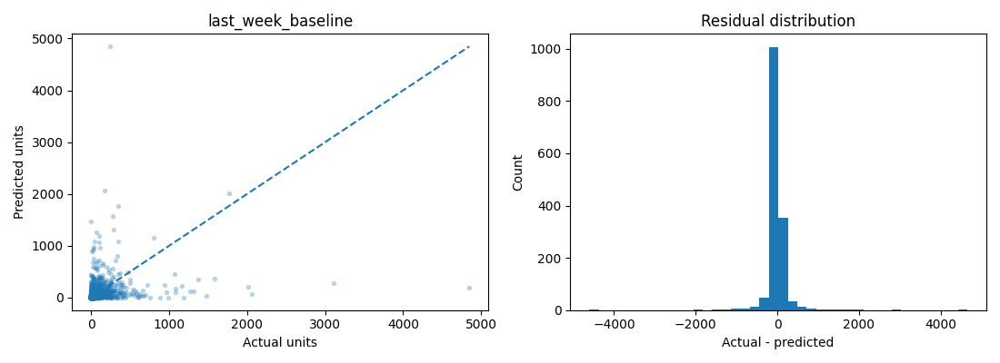

# Báo cáo Lab02 — Dự đoán số lượng sản phẩm bán theo ngày

Lần chạy thực nghiệm 20261111T193054Z-f51c7f83. Bốn thuật toán trong algorithms được tự cài bằng NumPy. Tiền xử lý và lớp ghép mô hình được tự cài bằng NumPy và pandas. Các chỉ số MAE, MSE, RMSE và R² cũng được tự tính bằng NumPy.

## 1. Xác định bài toán và mục tiêu

Mục tiêu sales là tổng số lượng bán dương của một sản phẩm trong một ngày. Mỗi hàng sau tổng hợp là một cặp StockCode và date. Kết quả là số thực không âm, đơn vị sản phẩm/ngày. Mô hình được chọn theo RMSE trên validation. Dự đoán hỗ trợ ước lượng nhu cầu cho sản phẩm đã có lịch sử. Đây là quyết định triển khai vì đề chỉ nêu doanh số dạng số và cho phép lựa chọn cách biểu diễn.

## 2. Thu thập và hiểu dữ liệu

Nguồn là data/raw/E-Commerc.csv, mã hóa cp1252, gồm 541.909 dòng giao dịch.

| Cột | Ý nghĩa và cách dùng |
| --- | --- |
| InvoiceNo | Mã hóa đơn, chữ C đầu mã biểu thị giao dịch hủy |
| StockCode | Mã sản phẩm để nhóm giao dịch và tạo đặc trưng phân loại |
| Description | Mô tả hàng hóa, giữ trong nguồn, chưa dùng trong mô hình |
| Quantity | Số lượng giao dịch, dùng tổng hợp mục tiêu |
| InvoiceDate | Thời gian giao dịch, dùng tạo ngày và chia tập |
| UnitPrice | Giá đơn vị, dùng kiểm tra giao dịch hợp lệ |
| CustomerID | Mã khách hàng, có dữ liệu thiếu |
| Country | Quốc gia giao dịch |

Nguồn chưa có quảng cáo, nhân khẩu học, review, rating và tồn kho. Chưa có đặc trưng lifetime value hoặc quảng cáo trong phiên bản này.

## 3. Khảo sát và kiểm tra dữ liệu

Kiểm tra trùng dòng, ngày lỗi, số lượng và giá không hợp lệ. Lần chạy có 522504 dòng giao dịch sau lọc. EDA lưu thống kê theo sản phẩm và biểu đồ tổng số lượng từng ngày. Cần đọc các đỉnh lớn cùng RMSE vì giao dịch bán buôn tạo sai số bình phương lớn.

## 4. Phân chia train, validation và test

Chia theo thứ tự ngày với cấu hình 60/20/20. Các sản phẩm trong cùng ngày thuộc cùng một tập. Chọn 20 sản phẩm có lượng bán lớn nhất trong giai đoạn train. Loại 28 ngày đầu thiếu lịch sử khiến số mẫu cuối lệch tỷ lệ danh nghĩa.

| split | rows |
| --- | --- |
| train | 3900 |
| validation | 1480 |
| test | 1500 |

Train kết thúc 2011-07-12. Validation kết thúc 2011-09-24. Test nằm sau mốc validation. Các tập CSV được lưu trong preprocessing của từng lần chạy.

## 5. Làm sạch và tiền xử lý

Loại bản trùng và giữ mã hàng dạng năm chữ số có thể kèm chữ cái. Loại giao dịch hủy, số lượng hoặc giá không dương, ngày không đọc được. Ngày đầu và ngày cuối bị loại vì có thể ghi nhận chưa đủ ngày. Giao dịch hợp lệ số lượng lớn được giữ lại vì có thể là đơn bán buôn. Đây là chính sách xử lý ngoại lệ, chưa winsorize doanh số. Tạo lưới đầy đủ sản phẩm/ngày và điền ngày không có giao dịch bằng 0. Giả định này chưa phân biệt hết hàng với thiếu nhu cầu.

## 6. Trích xuất và lựa chọn đặc trưng

Các đặc trưng số gồm lag_1, lag_7, mean_7, mean_28, month, weekday và day_of_year. Lag lấy số lượng ngày trước. Trung bình trượt đều shift một ngày trước khi rolling nên không dùng sales của chính ngày cần dự đoán.

StockCode được one-hot encoding. Imputer dùng trung vị và scaler học trên phần train tương ứng. Khi tuning, mọi bộ tiền xử lý chỉ fit trên train thử. Khi huấn luyện cuối, chúng được fit lại trên train cộng validation.

Test được đánh giá theo rolling one-step, dùng số bán thực tế của những ngày trước đó. Dự báo nhiều ngày liên tiếp sẽ cần cách cập nhật lịch sử riêng.

## 7. Xây dựng mô hình mốc

Baseline mean dự đoán trung bình sales trên train cộng validation cho mọi mẫu test. Baseline last_week lấy lag_7 của từng sản phẩm. Hai baseline dùng cùng tập test và chỉ số với bốn thuật toán.

| model | fit_seconds | mae | mse | rmse | r2 |
| --- | --- | --- | --- | --- | --- |
| mean_baseline | 0.0000 | 95.7001 | 51121.7215 | 226.1011 | -0.0002 |
| last_week_baseline | 0.0000 | 96.2567 | 77078.8940 | 277.6309 | -0.5081 |

## 8. Huấn luyện bốn thuật toán

### 8.1 Hồi quy tuyến tính Ridge

Class LinearRegression tự học bằng full-batch gradient descent. Khởi tạo trọng số và bias bằng 0. Mỗi vòng tính dự đoán Xw + b rồi lấy sai số e = dự đoán − y.

Hàm mục tiêu là (tổng bình phương sai số + alpha nhân tổng bình phương trọng số)/(2n). Gradient trọng số là (Xᵀe + alpha w)/n. Gradient bias là trung bình e. Cập nhật w bằng w − learning_rate nhân gradient trọng số và cập nhật b tương tự. Bias được miễn phạt. Số vòng lặp, learning rate và alpha khai báo trong YAML.

### 8.2 Decision Tree

Class DecisionTree tự xây cây đệ quy. Mỗi nút thử từng đặc trưng và tối đa 15 ngưỡng phân vị từ tập mẫu của nút. Chọn phép chia giảm tổng bình phương sai số nhiều nhất và đảm bảo số mẫu tối thiểu ở mỗi lá. Cây dừng theo max_depth, min_samples_leaf hoặc khi không còn cải thiện. Giá trị lá là trung bình mục tiêu.

Đây là cây dùng ứng viên ngưỡng phân vị để giới hạn chi phí tính toán. Kết quả có thể khác cây duyệt mọi điểm chia.

### 8.3 Random Forest

Class RandomForest tạo n_estimators cây. Mỗi cây học trên mẫu bootstrap có hoàn lại. Mỗi nút chọn ngẫu nhiên khoảng căn bậc hai số đặc trưng để tìm phép chia. Dự đoán là trung bình dự đoán các cây. Random seed được khai báo trong YAML.

### 8.4 Gradient Boosting

Class GradientBoosting khởi tạo bằng trung bình mục tiêu train. Mỗi vòng tính phần dư y − dự đoán hiện tại, học một cây nông để dự đoán phần dư, rồi cộng learning_rate nhân dự đoán của cây vào mô hình. Khi dự đoán, cộng lại toàn bộ cây theo đúng thứ tự.

Cả bốn thuật toán đều có fit(X, y) và predict(X). Model là alias trong từng module để giữ import hiện có.

## 9. So sánh cấu hình và tuning

config.yaml chứa danh sách alpha cho Ridge, độ sâu và kích thước lá cho cây, số cây và cấu hình rừng, cùng số vòng, độ sâu và learning rate cho boosting. Mỗi ứng viên được fit trên train rồi chấm RMSE validation. Mỗi họ thuật toán chọn cấu hình có RMSE thấp nhất.

| model | parameters | mae | mse | rmse | r2 |
| --- | --- | --- | --- | --- | --- |
| linear_regression | {'alpha': 1.0} | 83.2286 | 34863.3793 | 186.7174 | -0.3386 |
| linear_regression | {'alpha': 10.0} | 82.2407 | 34167.9865 | 184.8458 | -0.3119 |
| decision_tree | {'max_depth': 5, 'min_samples_leaf': 10} | 68.7246 | 26221.5029 | 161.9305 | -0.0068 |
| decision_tree | {'max_depth': 10, 'min_samples_leaf': 20} | 69.7299 | 27077.6793 | 164.5530 | -0.0397 |
| random_forest | {'n_estimators': 60, 'max_depth': 10, 'min_samples_leaf': 5} | 70.4484 | 24833.6040 | 157.5868 | 0.0465 |
| gradient_boosting | {'n_estimators': 60, 'max_depth': 2, 'learning_rate': 0.05} | 74.6473 | 26271.5073 | 162.0849 | -0.0087 |
| gradient_boosting | {'n_estimators': 100, 'max_depth': 2, 'learning_rate': 0.05} | 74.8542 | 27136.3293 | 164.7311 | -0.0419 |

Cấu hình đã chọn được lưu trong selection.json. Nếu đồng điểm, ứng viên đầu tiên trong YAML được giữ.

## 10. Phân tích sai số trên validation

Bài toán hồi quy so sánh dự đoán liên tục với giá trị thật. RMSE validation là tiêu chí chọn cấu hình. MAE giúp đọc sai số tuyệt đối thông thường, còn MSE nhấn mạnh các sai số lớn. Dự đoán âm được cắt về 0 cho tất cả thuật toán trước khi đánh giá.

| model | parameters |
| --- | --- |
| linear_regression | {'alpha': 10.0} |
| decision_tree | {'max_depth': 5, 'min_samples_leaf': 10} |
| random_forest | {'n_estimators': 60, 'max_depth': 10, 'min_samples_leaf': 5} |
| gradient_boosting | {'n_estimators': 60, 'max_depth': 2, 'learning_rate': 0.05} |

Các bảng validation trong lần chạy ghi đủ chỉ số từng cấu hình. Chưa có phân tích định tính từng giao dịch hoặc dự đoán validation từng dòng được lưu. Những phần này là giới hạn của phân tích lỗi hiện tại.

## 11. Chốt mô hình và đánh giá trên test

Fit lại mỗi cấu hình thắng trên train cộng validation. Test được biến đổi bằng bộ tiền xử lý vừa fit. Mô hình demo mặc định được chọn theo validation. So sánh các thuật toán trên test nhằm báo cáo hiệu năng.

| model | fit_seconds | mae | mse | rmse | r2 |
| --- | --- | --- | --- | --- | --- |
| linear_regression | 0.0131 | 87.6791 | 55371.9789 | 235.3125 | -0.0834 |
| decision_tree | 0.0844 | 77.0006 | 47906.8425 | 218.8763 | 0.0627 |
| random_forest | 6.2645 | 76.3146 | 46711.8420 | 216.1292 | 0.0861 |
| gradient_boosting | 1.2706 | 87.9482 | 50810.1504 | 225.4111 | 0.0059 |
| mean_baseline | 0.0000 | 95.7001 | 51121.7215 | 226.1011 | -0.0002 |
| last_week_baseline | 0.0000 | 96.2567 | 77078.8940 | 277.6309 | -0.5081 |

MAE cùng đơn vị số lượng. MSE có đơn vị bình phương. RMSE là căn MSE. R² có thể âm khi sai số lớn hơn mốc dự đoán trung bình tập đánh giá. R² của các mô hình còn thấp, nên hiệu năng giải thích biến động doanh số còn hạn chế.

## 12. Lưu mô hình, demo và giám sát

Mỗi lần chạy lưu hash dữ liệu, YAML, tập chia, bảng tuning, cấu hình chọn, dự đoán test và hình. Joblib chứa pipeline tiền xử lý và thuật toán tự cài. models/selection.json ghi tên mô hình demo và mã lần chạy. predict.py nhận StockCode, date, lag_1, lag_7, mean_7 và mean_28. Các đặc trưng lịch được tạo từ date. Chỉ các sản phẩm có trong models/products.json được hỗ trợ.

Chạy toàn bộ bằng python -m Lab02.src.pipeline từ thư mục gốc repository. Dùng python -m Lab02.src.predict --input với JSON chứa các trường trên để demo.

Hệ thống hiện có dự đoán cục bộ. API production, nguồn lịch sử tự cập nhật, dự báo nhiều bước, giám sát drift và phản hồi tồn kho là các phần phát triển tiếp. Khi có nhãn thực tế sau triển khai, có thể theo dõi MAE và RMSE theo ngày, theo sản phẩm và so với baseline.

Bộ xử lý tự cài học trung vị, trung bình, độ lệch chuẩn và danh sách mã sản phẩm từ train. Cột số thiếu hoàn toàn được điền 0. Cột hằng có hệ số chia bằng 1. Mã sản phẩm lạ khi transform cho vector one-hot toàn 0.

## Kiểm chứng theo thời gian và phân tích lỗi

Pipeline bổ sung ba cửa sổ train mở rộng, giữ nguyên thứ tự ngày. Điểm chọn cấu hình là RMSE trung bình của ba cửa sổ và validation cuối. Test chỉ dùng đánh giá sau khi chọn. Bảng walk_forward_metrics.csv lưu từng cửa sổ. Mỗi lượt lưu đủ CSV train/validation/test. Baseline bổ sung trung bình theo sản phẩm. Bảng lỗi lớn nhất và chỉ số theo sản phẩm/ngày trong tuần giúp tìm nơi dự báo thiếu hoặc dư.
