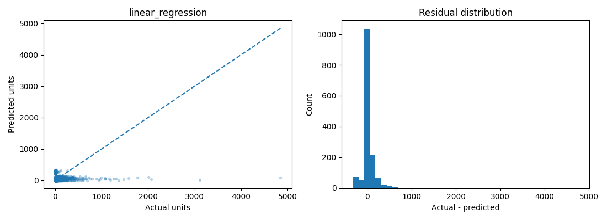
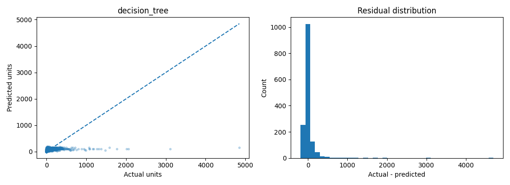
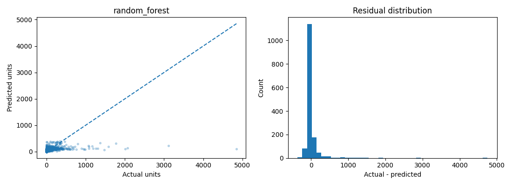
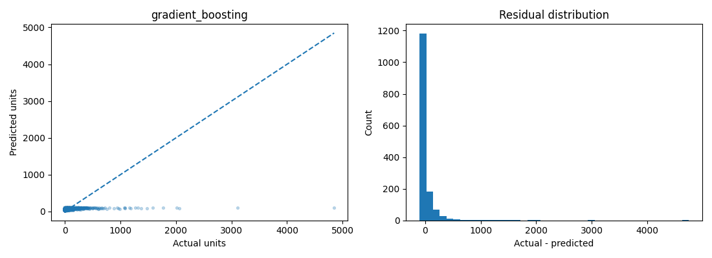
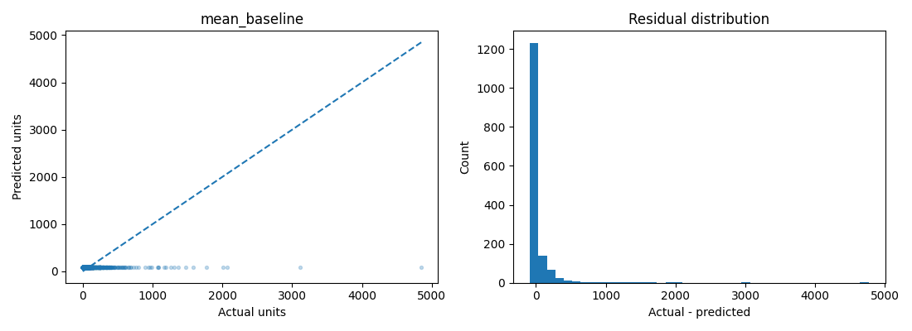
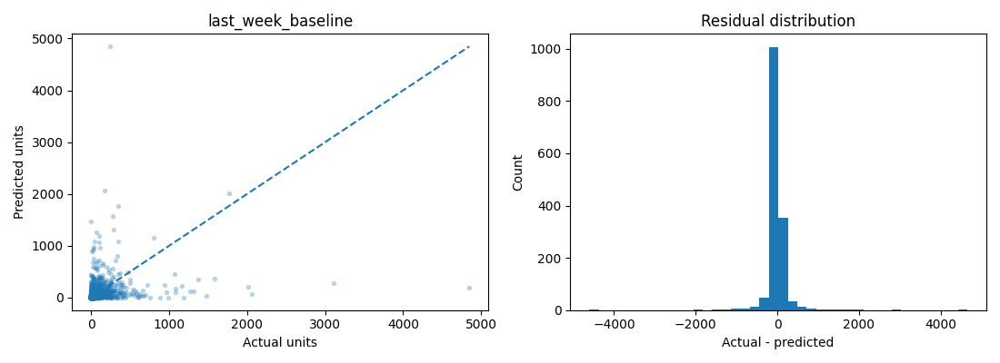

# Lab02 — Kết quả thực nghiệm

Dự đoán số lượng bán dương theo sản phẩm/ngày. Chọn mô hình bằng RMSE validation.

## Kết quả test

model,fit_seconds,mae,mse,rmse,r2
linear_regression,0.008186200000181998,87.67909382716276,55371.97892271759,235.312513315203,-0.08337028423497994
decision_tree,0.018123199999990902,77.42113474601761,47919.01898368722,218.90413194749712,0.06244923467382657
random_forest,0.14305749999994077,80.84049641134222,46487.46900939098,215.6095290319771,0.09045796278366136
gradient_boosting,0.33105550000027506,83.0217198095382,49081.50160981394,221.54345309625816,0.03970489434886071
mean_baseline,0.0,95.70013184634449,51121.72150639709,226.1011311479823,-0.00021265333980102774
last_week_baseline,0.0,96.25666666666666,77078.894,277.6308592357845,-0.5080729445816881

## Phạm vi đánh giá

Đánh giá từng ngày với lịch sử bán thực tế đến hết ngày trước đó. Các ngày không ghi nhận giao dịch được xem là 0. Chọn 20 sản phẩm bán nhiều nhất từ train. Mô hình chỉ áp dụng cho nhóm sản phẩm này và dữ liệu lịch sử cùng nguồn.

MAE là sai số tuyệt đối trung bình. MSE là sai số bình phương trung bình. RMSE là căn MSE, cùng đơn vị số lượng. R² so sánh sai số với dự đoán trung bình của tập đánh giá.

## Biểu đồ

