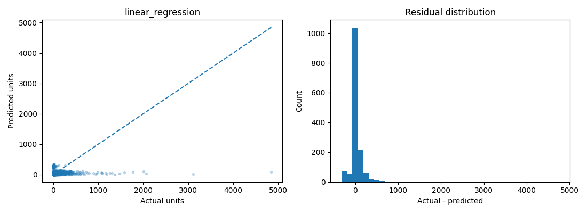
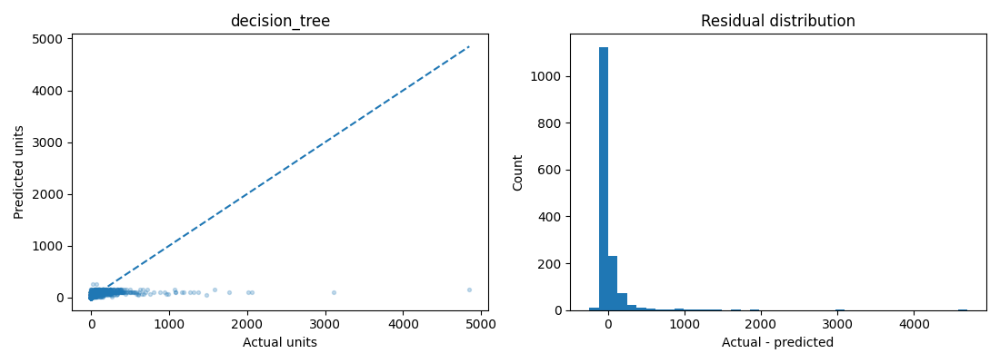
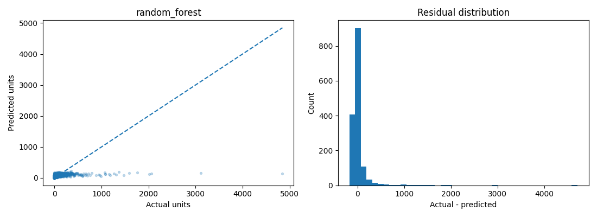
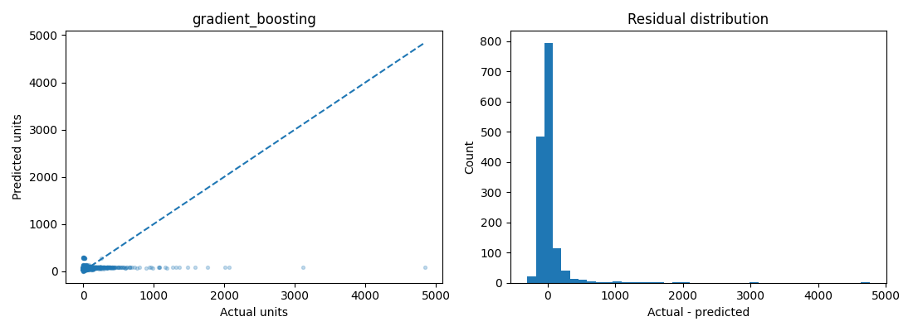
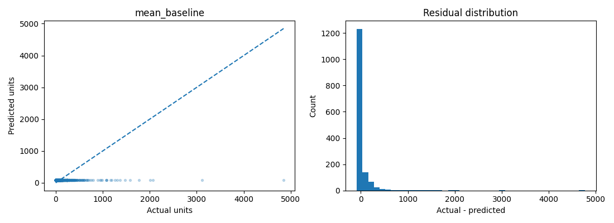
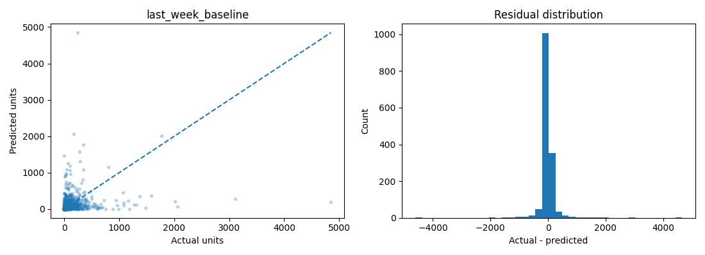

# Lab02 — Kết quả thực nghiệm

Dự đoán số lượng bán dương theo sản phẩm/ngày. Chọn mô hình bằng RMSE validation.

## Kết quả test

model,fit_seconds,mae,mse,rmse,r2
linear_regression,0.02135530000032304,87.67909382716262,55371.9789227175,235.3125133152028,-0.08337028423497816
decision_tree,0.33022799999980634,77.00056887193723,47906.842460659136,218.87631772455222,0.06268747219884518
random_forest,22.041695400000208,76.31462279363843,46711.84202306426,216.1292252867813,0.08606803379201122
gradient_boosting,3.6442016999999396,87.94819114098209,50810.15039742827,225.41106982006954,0.005883333970930216
mean_baseline,0.0,95.70013184634449,51121.72150639709,226.1011311479823,-0.00021265333980102774
last_week_baseline,0.0,96.25666666666666,77078.894,277.6308592357845,-0.5080729445816881

## Phạm vi đánh giá

Đánh giá từng ngày với lịch sử bán thực tế đến hết ngày trước đó. Các ngày không ghi nhận giao dịch được xem là 0. Chọn 20 sản phẩm bán nhiều nhất từ train. Mô hình chỉ áp dụng cho nhóm sản phẩm này và dữ liệu lịch sử cùng nguồn.

MAE là sai số tuyệt đối trung bình. MSE là sai số bình phương trung bình. RMSE là căn MSE, cùng đơn vị số lượng. R² so sánh sai số với dự đoán trung bình của tập đánh giá.

## Biểu đồ

