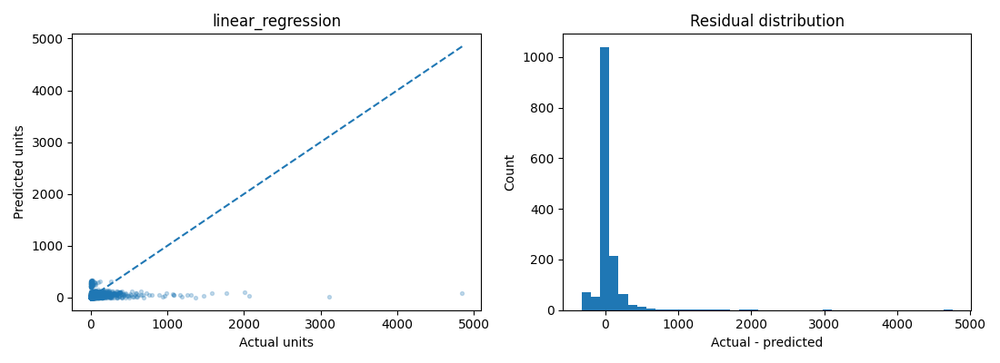
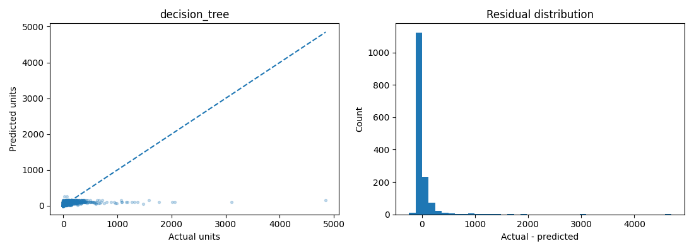
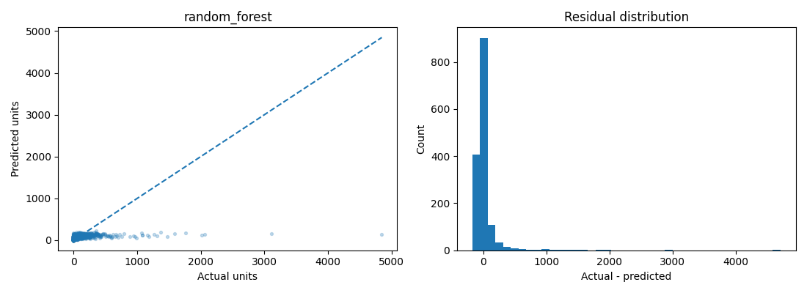
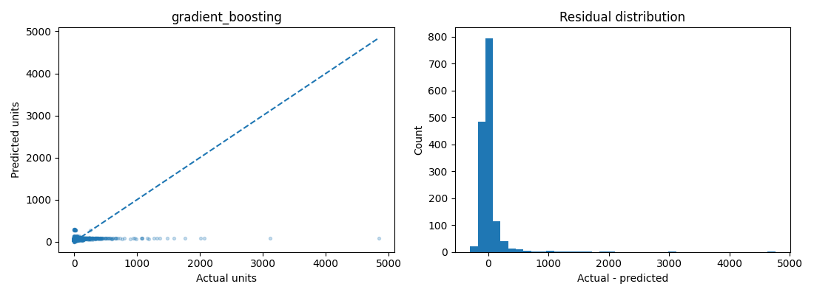
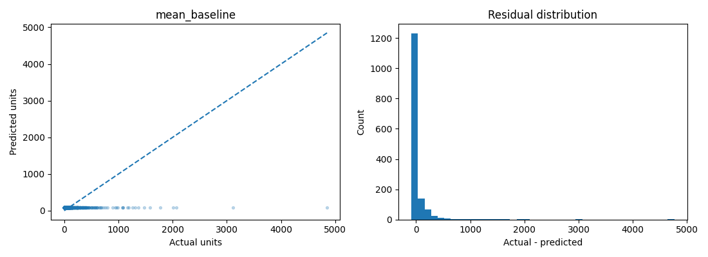
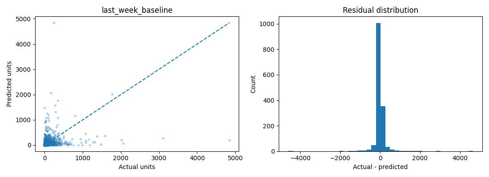
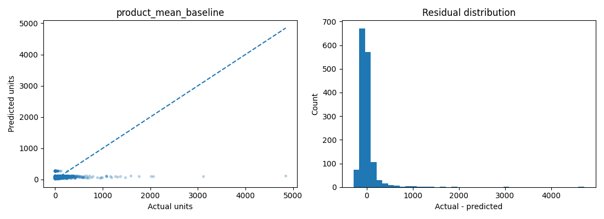
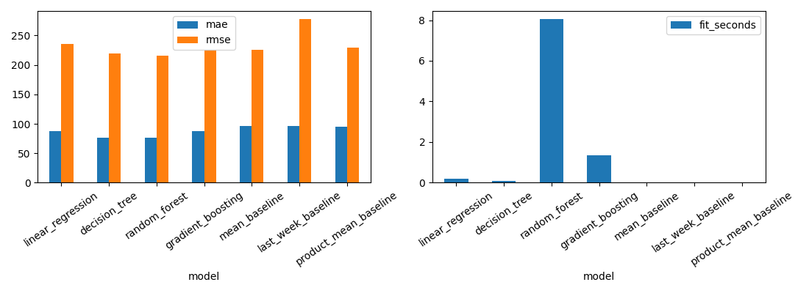

# Lab02 — Kết quả thực nghiệm

Dự đoán số lượng bán dương theo sản phẩm/ngày. Chọn mô hình bằng RMSE trung bình của ba cửa sổ mở rộng trên train và validation cuối.

## Kết quả test

| model | fit_seconds | mae | mse | rmse | r2 |
| --- | --- | --- | --- | --- | --- |
| linear_regression | 0.1948 | 87.6790 | 55371.4034 | 235.3113 | -0.0834 |
| decision_tree | 0.0796 | 77.0006 | 47906.8425 | 218.8763 | 0.0627 |
| random_forest | 8.0487 | 76.3146 | 46711.8420 | 216.1292 | 0.0861 |
| gradient_boosting | 1.3526 | 87.9482 | 50810.1504 | 225.4111 | 0.0059 |
| mean_baseline | 0.0000 | 95.7001 | 51121.7215 | 226.1011 | -0.0002 |
| last_week_baseline | 0.0000 | 96.2567 | 77078.8940 | 277.6309 | -0.5081 |
| product_mean_baseline | 0.0000 | 95.4789 | 52808.5168 | 229.8010 | -0.0332 |

## Phạm vi đánh giá

Đánh giá từng ngày với lịch sử bán thực tế đến hết ngày trước đó. Các ngày không ghi nhận giao dịch được xem là 0. Chọn 20 sản phẩm bán nhiều nhất từ train. Mô hình chỉ áp dụng cho nhóm sản phẩm này và dữ liệu lịch sử cùng nguồn.

MAE là sai số tuyệt đối trung bình. MSE là sai số bình phương trung bình. RMSE là căn MSE, cùng đơn vị số lượng. R² so sánh sai số với dự đoán trung bình của tập đánh giá.

## Biểu đồ

## Phân tích sai số

Các bảng *_largest_errors.csv lưu 10 lỗi lớn nhất. Các bảng *_StockCode_metrics.csv và *_weekday_metrics.csv phân tích theo sản phẩm và ngày trong tuần.
Residual dương là dự báo thiếu, residual âm là dự báo dư.
