# Lab02 — Kết quả thực nghiệm

Nguồn data/raw/FMCG_2022_2024.csv. Revenue được tính bằng price_unit × units_sold cho mỗi dòng hợp lệ, rồi cộng gộp theo sku × tuần qua tất cả channel, region và pack_type. Tuần từ thứ Hai đến Chủ nhật. Chọn tối đa 20 sku theo Revenue train, có doanh thu dương ở ít nhất 6 tuần train. Tuần thiếu giao dịch được quy ước Revenue bằng 0. Đầu vào dự báo chỉ dùng lịch sử Revenue và lịch của tuần cần dự báo.

## Khoảng thời gian dữ liệu

Ngày kết thúc dưới đây bao gồm Chủ nhật cuối tuần.

- train: 08/08/2022 đến 22/10/2023, 1260 mẫu
- validation: 23/10/2023 đến 26/05/2024, 620 mẫu
- test: 27/05/2024 đến 29/12/2024, 620 mẫu

Dự đoán doanh thu Revenue theo sku/tuần. Chọn mô hình bằng RMSE trung bình của ba cửa sổ mở rộng trên train và validation cuối.

## Kết quả test

| model | fit_seconds | mae | mse | rmse | r2 |
| --- | --- | --- | --- | --- | --- |
| linear_regression | 0.1439 | 553.3854 | 479512.6627 | 692.4685 | 0.6704 |
| decision_tree | 0.5278 | 571.7894 | 520245.5317 | 721.2805 | 0.6424 |
| random_forest | 13.3672 | 532.7812 | 450546.9071 | 671.2279 | 0.6903 |
| gradient_boosting | 2.7943 | 546.2439 | 470837.1209 | 686.1757 | 0.6763 |
| mean_baseline | 0.0000 | 1005.8798 | 1507720.7675 | 1227.8928 | -0.0364 |
| last_week_baseline | 0.0000 | 910.3548 | 1373675.8889 | 1172.0392 | 0.0557 |
| rolling_7_baseline | 0.0000 | 606.0890 | 595377.8900 | 771.6073 | 0.5907 |
| rolling_28_baseline | 0.0000 | 1057.0406 | 1661167.8487 | 1288.8630 | -0.1419 |
| weekday_4_baseline | 0.0000 | 1208.4414 | 2180316.5278 | 1476.5895 | -0.4987 |
| product_mean_baseline | 0.0000 | 973.9377 | 1419390.9349 | 1191.3819 | 0.0243 |

## Phạm vi đánh giá

Đánh giá từng tuần với lịch sử bán thực tế đến hết tuần trước đó. Các tuần không ghi nhận giao dịch được xem là 0. Đối tượng dự báo là sku, gồm 20 sku được chọn từ train. Mô hình chỉ áp dụng cho nhóm sản phẩm này và dữ liệu lịch sử cùng nguồn.

MAE là sai số tuyệt đối trung bình. MSE là sai số bình phương trung bình. RMSE là căn MSE, cùng đơn vị doanh thu nguồn. R² so sánh sai số với dự đoán trung bình của tập đánh giá.

## Biểu đồ

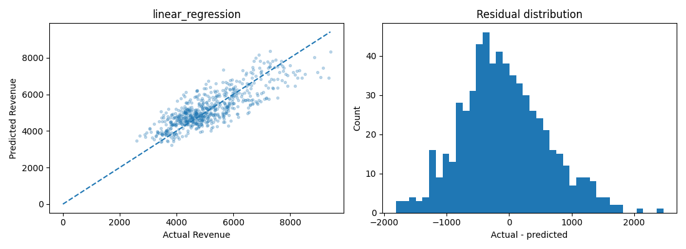

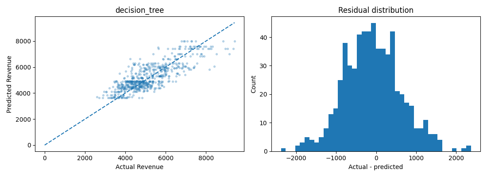

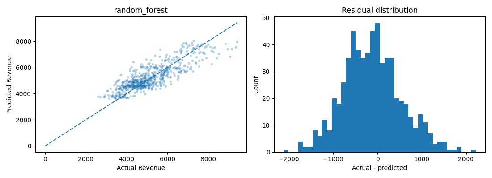

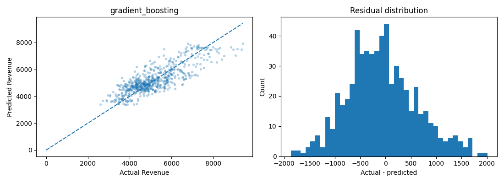

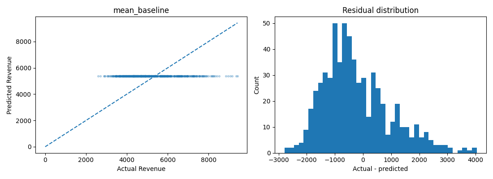

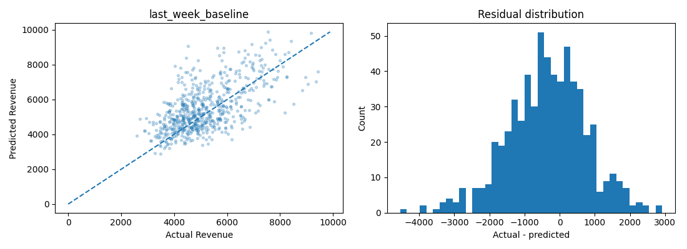

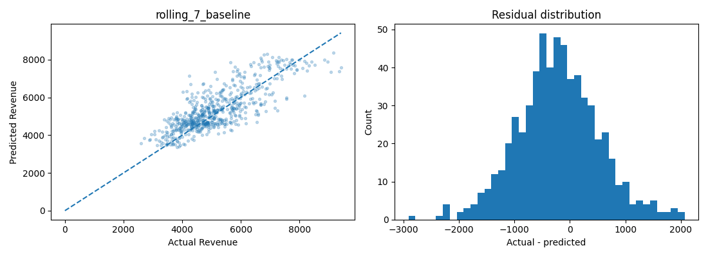

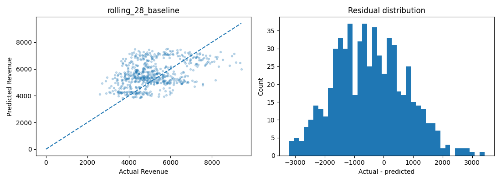

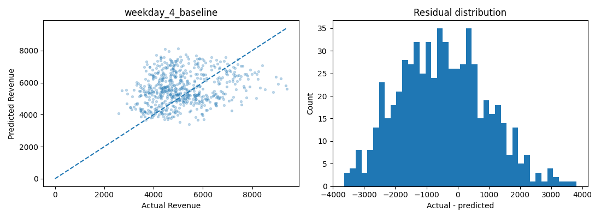

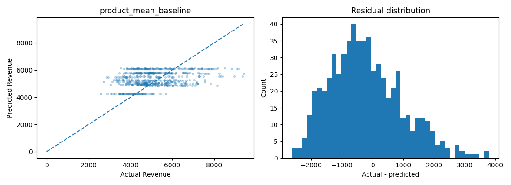

## Phân tích sai số

Các bảng *_largest_errors.csv lưu 10 lỗi lớn nhất. Các bảng *_sku_metrics.csv và *_weekday_metrics.csv phân tích theo sản phẩm và ngày trong tuần.
Residual dương là dự báo thiếu, residual âm là dự báo dư.
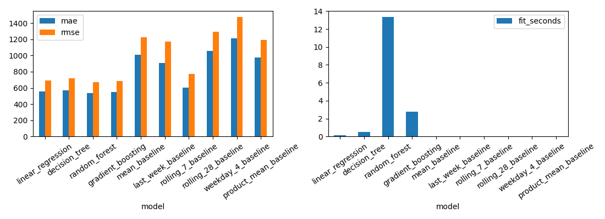

## Kết luận và giới hạn

Mô hình được chọn bằng dữ liệu phát triển là **gradient_boosting**. RMSE test 686.1757, R² 0.6763. Mức giảm RMSE so với baseline trung bình là 44.12%.
R² test của mô hình được chọn là 0.6763. Kết quả phản ánh một lần chia theo thời gian. Không dùng bảng test để chọn lại cấu hình.
Top sản phẩm được cố định từ toàn bộ train trước walk-forward. Các fold kiểm chứng dự báo trong phạm vi sản phẩm này, chưa mô phỏng việc chọn lại danh mục tại từng mốc quá khứ.
Không có giao dịch được quy ước là 0, nhưng dữ liệu không phân biệt hết hàng, đóng cửa và không có nhu cầu. Chỉ giữ tuần đầy đủ từ thứ Hai đến Chủ nhật.
Các đặc trưng robust gồm trung vị, độ lệch chuẩn 7/28 tuần, số tuần doanh thu 0, trung bình cùng thứ bốn mốc cách 7 tuần và cờ cuối tuần. Tất cả chỉ dùng lịch sử trước ngày dự báo.

## Các lỗi lớn nhất của mô hình được chọn

| sku | Tuần bắt đầu | Revenue thực tế | Dự đoán | Sai số tuyệt đối |
| --- | --- | --- | --- | --- |
| YO-012 | 2024-07-22 | 9059.57 | 7050.62 | 2008.95 |
| YO-016 | 2024-06-10 | 9360.71 | 7470.17 | 1890.54 |
| JU-021 | 2024-08-26 | 4322.19 | 6192.14 | 1869.95 |
| YO-029 | 2024-07-01 | 5640.78 | 7504.22 | 1863.44 |
| MI-006 | 2024-07-29 | 3634.04 | 5379.80 | 1745.76 |

Mô hình cải thiện RMSE so với baseline trung bình trên 20/20 sản phẩm. Xem evaluation/product_baseline_comparison.csv để đối chiếu từng sản phẩm với các baseline lịch sử.

Baseline trung bình 28 tuần đạt RMSE 1288.8630, trong khi mô hình được chọn đạt 686.1757. Mức giảm RMSE so với baseline này là 46.76%.

## Định nghĩa mục tiêu và dữ liệu

Đơn vị source price_unit currency. Công thức price_unit * units_sold; negative units excluded; zero units retained. Số dòng nguồn 190757, số dòng hợp lệ 190754, loại 3 dòng không hợp lệ sau loại trùng.

## Lựa chọn bằng validation và kết quả test

Điểm chọn cấu hình là selection_rmse, trung bình RMSE của ba cửa sổ train mở rộng và validation cuối. Cấu hình được chốt trước khi đánh giá test.
**random_forest** có RMSE thấp nhất trên test trong bảng này. **gradient_boosting** là mô hình được chọn từ validation và dùng mặc định để dự đoán. Thứ hạng test được dùng để mô tả kết quả, không dùng để thay đổi mô hình đã chọn.

## Cấu hình được chọn

- **linear_regression** — {"alpha": 10.0, "learning_rate": 0.1, "n_iterations": 3000, "feature_set": "robust"}
- **decision_tree** — {"max_depth": 10, "min_samples_leaf": 20, "feature_set": "trend"}
- **random_forest** — {"n_estimators": 80, "max_depth": 14, "min_samples_leaf": 10, "feature_set": "robust"}
- **gradient_boosting** — {"n_estimators": 100, "max_depth": 2, "learning_rate": 0.05, "feature_set": "trend"}

## EDA

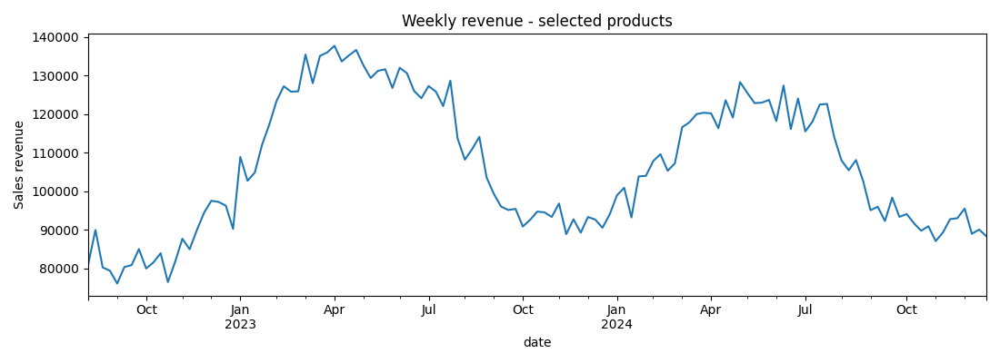
