# Lab02 — Kết quả thực nghiệm

Dự đoán số lượng bán dương theo sản phẩm/ngày. Chọn mô hình bằng RMSE trung bình của ba cửa sổ mở rộng trên train và validation cuối.

## Kết quả test

| model | fit_seconds | mae | mse | rmse | r2 |
| --- | --- | --- | --- | --- | --- |
| linear_regression | 0.2675 | 76.3529 | 45557.5353 | 213.4421 | 0.1087 |
| decision_tree | 0.1081 | 77.5818 | 47927.7569 | 218.9241 | 0.0623 |
| random_forest | 8.3417 | 78.4745 | 46317.0759 | 215.2140 | 0.0938 |
| gradient_boosting | 1.7710 | 87.9482 | 50810.1504 | 225.4111 | 0.0059 |
| mean_baseline | 0.0000 | 95.7001 | 51121.7215 | 226.1011 | -0.0002 |
| last_week_baseline | 0.0000 | 96.2567 | 77078.8940 | 277.6309 | -0.5081 |
| rolling_7_baseline | 0.0000 | 89.0090 | 50427.5084 | 224.5607 | 0.0134 |
| rolling_28_baseline | 0.0000 | 82.1792 | 46341.1126 | 215.2699 | 0.0933 |
| weekday_4_baseline | 0.0000 | 85.3017 | 52048.3475 | 228.1411 | -0.0183 |
| product_mean_baseline | 0.0000 | 95.4789 | 52808.5168 | 229.8010 | -0.0332 |

## Phạm vi đánh giá

Đánh giá từng ngày với lịch sử bán thực tế đến hết ngày trước đó. Các ngày không ghi nhận giao dịch được xem là 0. Chọn 20 sản phẩm bán nhiều nhất từ train. Mô hình chỉ áp dụng cho nhóm sản phẩm này và dữ liệu lịch sử cùng nguồn.

MAE là sai số tuyệt đối trung bình. MSE là sai số bình phương trung bình. RMSE là căn MSE, cùng đơn vị số lượng. R² so sánh sai số với dự đoán trung bình của tập đánh giá.

## Biểu đồ

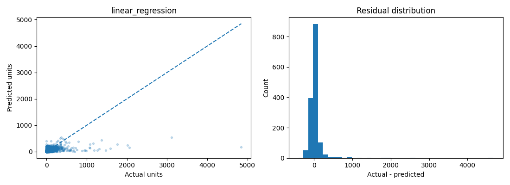

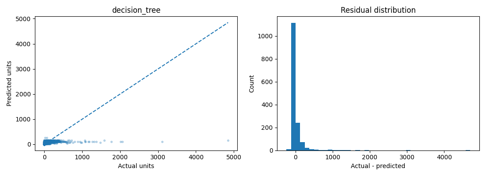

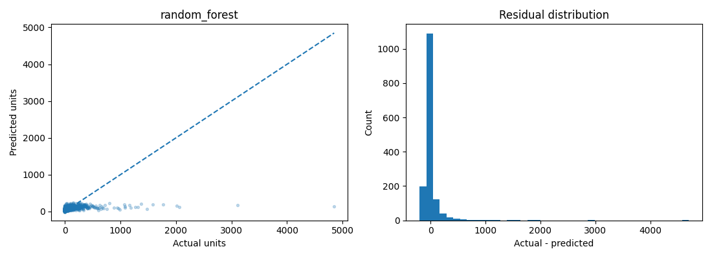

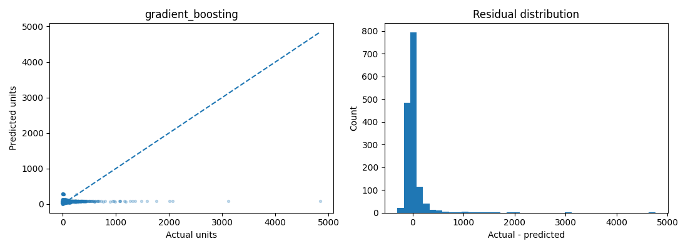

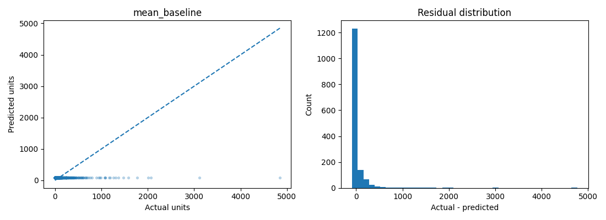

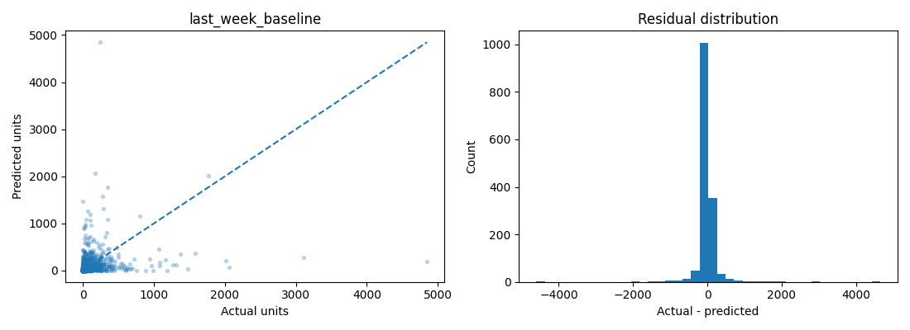

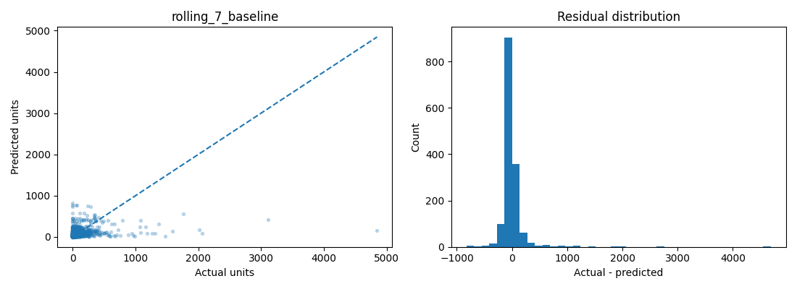

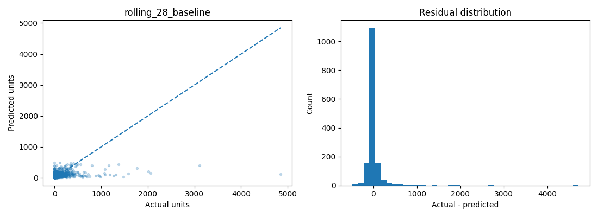

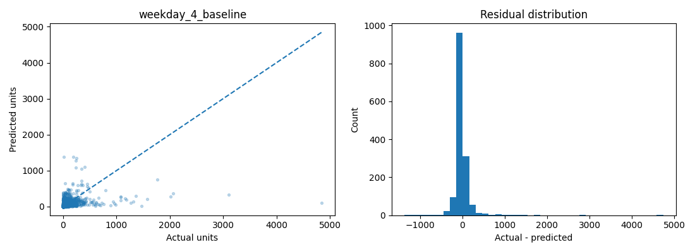

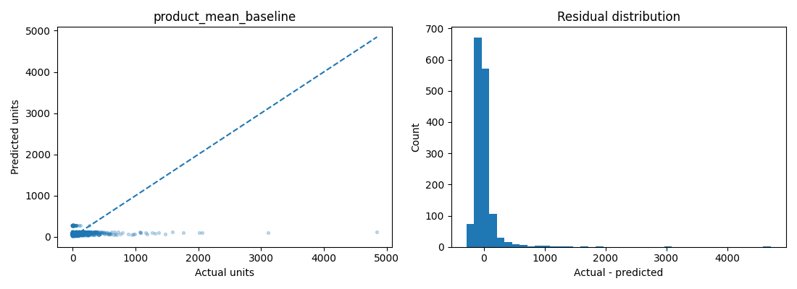

## Phân tích sai số

Các bảng *_largest_errors.csv lưu 10 lỗi lớn nhất. Các bảng *_StockCode_metrics.csv và *_weekday_metrics.csv phân tích theo sản phẩm và ngày trong tuần.
Residual dương là dự báo thiếu, residual âm là dự báo dư.
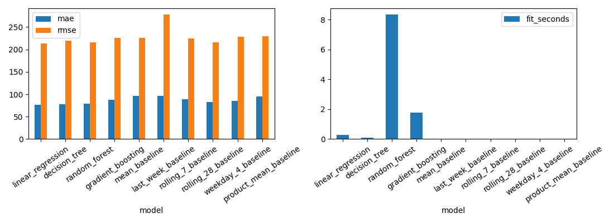

## Kết luận và giới hạn

Mô hình được chọn bằng dữ liệu phát triển là **random_forest**. RMSE test 215.2140, R² 0.0938. Mức giảm RMSE so với baseline trung bình là 4.82%.
R² thấp cho thấy mô hình còn hạn chế trong giải thích biến động doanh số. Không dùng bảng test để chọn lại cấu hình.
Top sản phẩm được cố định từ toàn bộ train trước walk-forward. Các fold kiểm chứng dự báo trong phạm vi sản phẩm này, chưa mô phỏng việc chọn lại danh mục tại từng mốc quá khứ.
Không có giao dịch được quy ước là 0, nhưng dữ liệu không phân biệt hết hàng, đóng cửa và không có nhu cầu. Hai ngày biên bị loại theo giả định dữ liệu có thể chưa đủ ngày.
Các đặc trưng robust gồm trung vị, độ lệch chuẩn 7/28 ngày, số ngày doanh số 0, trung bình cùng thứ bốn tuần và cuối tuần. Tất cả chỉ dùng lịch sử trước ngày dự báo.

## Các lỗi lớn nhất của mô hình được chọn

| Sản phẩm | Ngày | Thực tế | Dự đoán | Sai số tuyệt đối |
| --- | --- | --- | --- | --- |
| 84077 | 2011-10-27 | 4848.00 | 146.15 | 4701.85 |
| 22197 | 2011-12-08 | 3111.00 | 174.30 | 2936.70 |
| 22197 | 2011-10-28 | 2065.00 | 124.80 | 1940.20 |
| 22197 | 2011-11-07 | 2012.00 | 147.10 | 1864.90 |
| 22197 | 2011-11-14 | 1767.00 | 186.99 | 1580.01 |

Mô hình cải thiện RMSE so với baseline trung bình trên 17/20 sản phẩm. Xem evaluation/product_baseline_comparison.csv để đối chiếu từng sản phẩm với các baseline lịch sử.

Baseline trung bình 28 ngày đạt RMSE 215.2699, trong khi mô hình được chọn đạt 215.2140. Chênh lệch nhỏ cho thấy lợi ích hiện tại của mô hình phức tạp còn hạn chế.

So sánh trước/sau được lưu trong evaluation/before_after.csv. Đây là đối chiếu mô tả trên cùng test, không phải bằng chứng cải thiện trên một tập test mới độc lập.