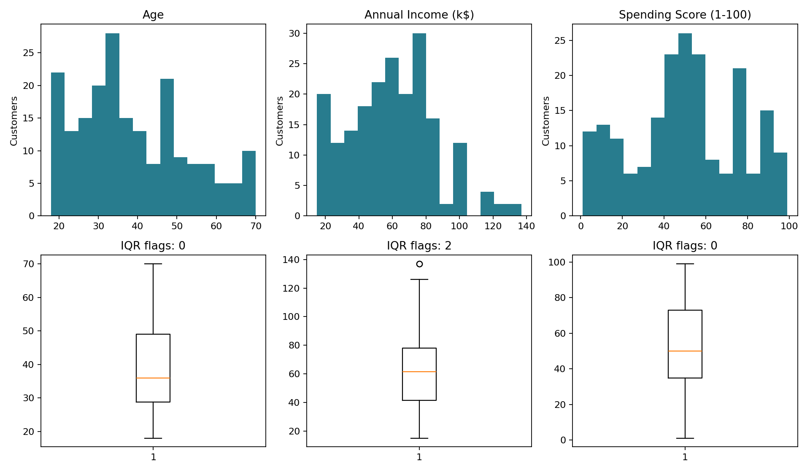
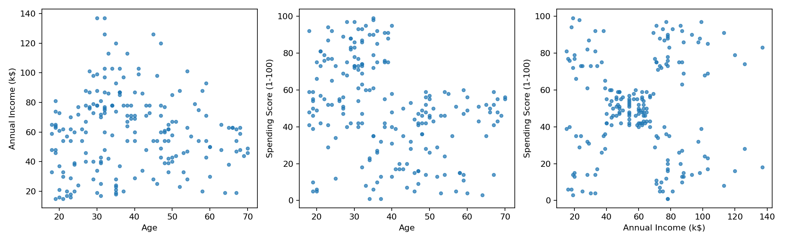
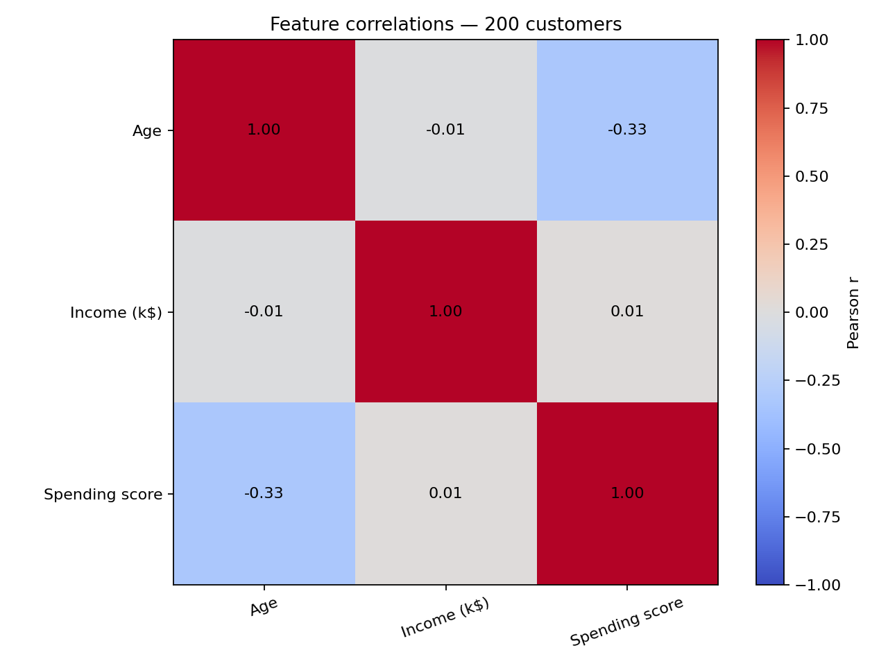
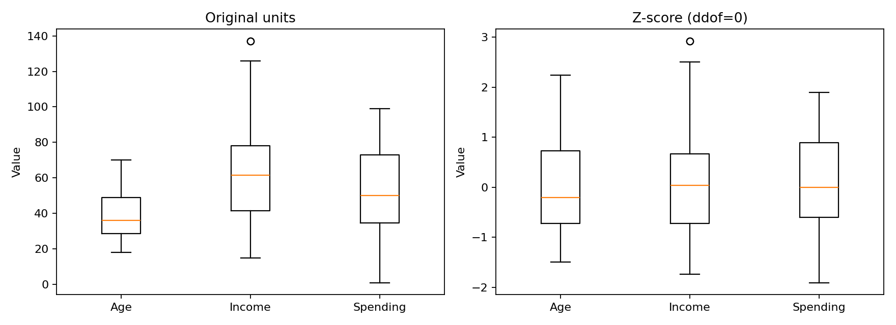
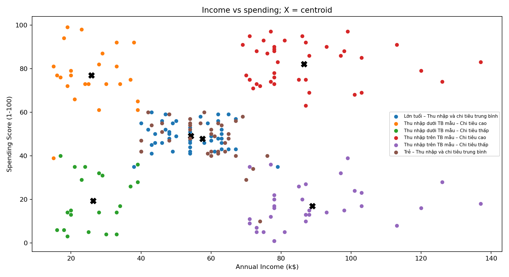
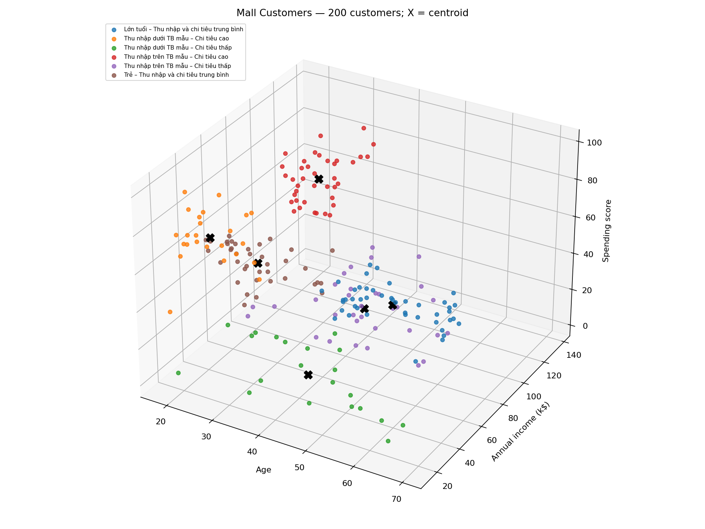
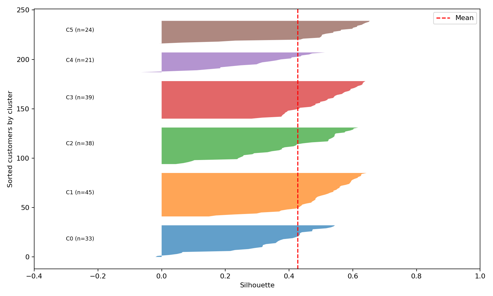
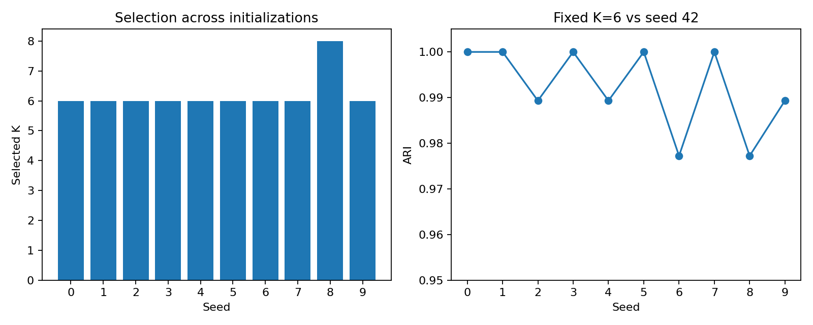
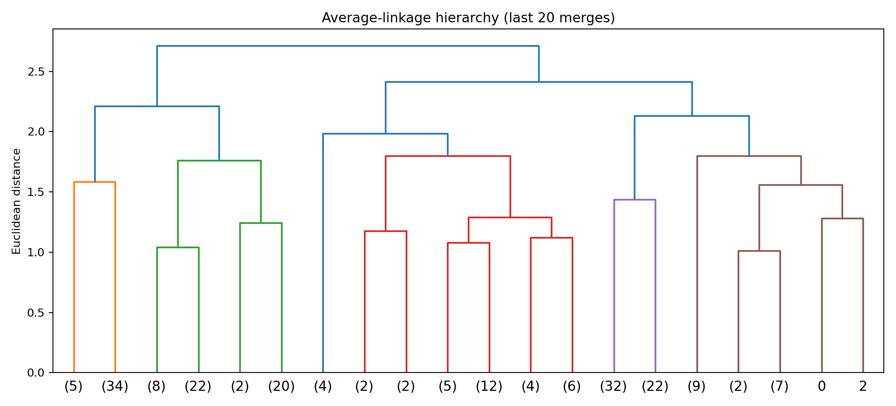
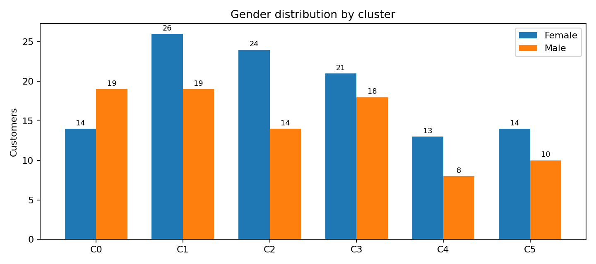

# Lab03 — Mall Customers

## 1. Mục tiêu và dữ liệu

Phân khúc mô tả toàn bộ 200 khách trong Mall_Customers.csv theo tuổi, thu nhập năm (nghìn USD) và điểm chi tiêu. CustomerID chỉ truy nguyên, Gender dùng mô tả sau phân cụm.

## 2. Khảo sát dữ liệu

Không có giá trị thiếu hoặc ID trùng. EDA ghi histogram, boxplot, scatter các cặp đặc trưng và cờ ngoại lệ 1,5 IQR. Khách có thu nhập cao hợp lệ được giữ lại.

*Hình 1. Histogram cho biết phân bố từng đặc trưng, boxplot đánh dấu các giá trị xa phần lớn mẫu theo IQR.*

*Hình 2. Các cặp đặc trưng trước phân cụm giúp quan sát xu hướng và các vùng khách tập trung.*

*Hình 3. Tương quan Pearson giữa các đặc trưng. Giá trị gần 0 chỉ nói quan hệ tuyến tính yếu, chưa loại trừ quan hệ khác.*

## 3. Phạm vi và chuẩn hóa

Kiểm tra tuổi trong 1–100, thu nhập dương và điểm trong 1–100. Cả 200 dòng hợp lệ, không cần lọc bỏ. Chuẩn hóa z-score với ddof=0 trên toàn bộ mẫu để phân cụm mô tả. Đây là đánh giá nội bộ, không phải dự báo train/test.

*Hình 4. Z-score đưa ba đặc trưng về thang đo tương đương, tránh thu nhập hoặc tuổi chi phối khoảng cách chỉ vì đơn vị đo.*

## 4. K-Means tự cài

K-means++ khởi tạo, mỗi vòng gán khách gần tâm rồi cập nhật tâm trung bình. Cụm rỗng đặt lại ở điểm xa nhất. Dừng theo độ dịch chuyển tâm tol=0,0001 hoặc max_iter=300. Mỗi K chạy n_init=20, giữ nghiệm inertia thấp nhất. Silhouette tự cài theo khoảng cách Euclid trên z-score.

## 5. So sánh K và Elbow

| k | silhouette | inertia | n_iter | converged |
| --- | --- | --- | --- | --- |
| 2 | 0.3355 | 389.3862 | 7 | True |
| 3 | 0.3578 | 295.2122 | 4 | True |
| 4 | 0.4040 | 205.2251 | 7 | True |
| 5 | 0.4166 | 168.2476 | 8 | True |
| 6 | 0.4274 | 133.8683 | 14 | True |
| 7 | 0.4172 | 117.0116 | 13 | True |
| 8 | 0.4085 | 104.1276 | 7 | True |
| 9 | 0.4208 | 92.2932 | 7 | True |
| 10 | 0.3995 | 81.9635 | 6 | True |

K=6 đạt 0,4274, K=5 đạt 0,4166, K=9 đạt 0,4208. Chênh lệch nhỏ nên K=6 là lựa chọn có điều kiện. Inertia giảm 94,17 khi tăng K=2 lên 3 và 89,99 khi tăng K=3 lên 4. Mức giảm còn 36,98 ở K=4 lên 5 và 34,38 ở K=5 lên 6. Từ K=6 lên 7 chỉ giảm 16,86, các bước sau giảm khoảng 10–13. Vì vậy Elbow gợi ý vùng K=4–6, chưa xác định duy nhất K=6. So với K=5, nghiệm K=6 phân biệt thêm nhóm trẻ chi tiêu vừa với nhóm thu nhập dưới trung bình chi tiêu cao. K=5 vẫn là lựa chọn gọn hơn nếu chỉ cần ít phân khúc.

*Hình 5. Silhouette đạt cao nhất ở K=6 trong lần chạy tham chiếu. Inertia giảm chậm hơn sau vùng K=4–6.*

## 6. Phân khúc và marketing

| cluster | customer_count | Age_mean | Annual Income (k$)_mean | Spending Score (1-100)_mean | segment | marketing_hypothesis |
| --- | --- | --- | --- | --- | --- | --- |
| 0 | 33 | 41.9394 | 88.9394 | 16.9697 | Thu nhập trên TB mẫu – Chi tiêu thấp | Khảo sát nhu cầu, thử ưu đãi cá nhân hóa và đo mức tăng chi tiêu. |
| 1 | 45 | 56.3333 | 54.2667 | 49.0667 | Lớn tuổi – Thu nhập và chi tiêu trung bình | Thử dịch vụ thuận tiện và chương trình duy trì khách hàng. |
| 2 | 38 | 26.6842 | 57.5789 | 47.7895 | Trẻ – Thu nhập và chi tiêu trung bình | Thử giới thiệu sản phẩm mới và chương trình tích điểm. |
| 3 | 39 | 32.6923 | 86.5385 | 82.1282 | Thu nhập trên TB mẫu – Chi tiêu cao | Ưu tiên trải nghiệm VIP, quyền lợi thành viên và bán thêm phù hợp. |
| 4 | 21 | 45.5238 | 26.2857 | 19.3810 | Thu nhập dưới TB mẫu – Chi tiêu thấp | Thử sản phẩm thiết yếu, ưu đãi tiết kiệm và giới hạn chi phí tiếp cận. |
| 5 | 24 | 25.2500 | 25.8333 | 76.9167 | Thu nhập dưới TB mẫu – Chi tiêu cao | Thử ưu đãi theo ngân sách và combo giá trị, theo dõi biên lợi nhuận. |

Tên thu nhập trên/dưới trung bình mẫu là tương đối, tính theo thu nhập trung bình thường của 200 khách (60,56 nghìn USD/năm). Chi tiêu thấp ≤35, cao ≥65, tuổi chia mốc 40 cho nhóm giữa. Đây là ngưỡng diễn giải sau phân cụm. Marketing là giả thuyết cần thí nghiệm đối chứng, chưa chứng minh lợi nhuận.

## 7. Trực quan

Biểu đồ Income × Spending và Plotly 3D dùng đơn vị gốc, thu nhập nghìn USD. Legend có tên nhóm và tâm cụm. Khoảng cách mô hình dùng z-score. Biểu đồ Silhouette từng cụm chỉ ra khách sát ranh giới. Scatter 2D có thể chồng lấn vì chưa hiển thị tuổi.

*Hình 6. Màu thể hiện phân khúc, dấu X là tâm chiếu lên hai trục. Hai nhóm khác tuổi có thể chồng lấn trên hình này.*

*Hình 7. Thêm trục tuổi giúp đọc các nhóm chồng lấn trên biểu đồ hai chiều.*

[Biểu đồ 3D có thể xoay và thu phóng](../results/runs/2026-11-18_19-38-16/figures/customer_clusters_3d.html)

*Hình 8. Mỗi nhóm thanh tương ứng một cụm. Đường đỏ là Silhouette trung bình, giá trị âm chỉ khách gần cụm khác hơn theo tiêu chí khoảng cách trung bình.*

## 8. Ổn định khởi tạo

| seed | selected_k | silhouette | ari_selected_vs_reference | fixed_k | ari_fixed_vs_reference |
| --- | --- | --- | --- | --- | --- |
| 0 | 6 | 0.4274 | 1.0000 | 6 | 1.0000 |
| 1 | 6 | 0.4274 | 1.0000 | 6 | 1.0000 |
| 2 | 6 | 0.4284 | 0.9893 | 6 | 0.9893 |
| 3 | 6 | 0.4274 | 1.0000 | 6 | 1.0000 |
| 4 | 6 | 0.4284 | 0.9893 | 6 | 0.9893 |
| 5 | 6 | 0.4274 | 1.0000 | 6 | 1.0000 |
| 6 | 6 | 0.4269 | 0.9772 | 6 | 0.9772 |
| 7 | 6 | 0.4274 | 1.0000 | 6 | 1.0000 |
| 8 | 8 | 0.4277 | 0.7604 | 6 | 0.9772 |
| 9 | 6 | 0.4284 | 0.9893 | 6 | 0.9893 |

9/10 seed chọn K=6, seed 8 chọn K=8. ARI cố định K=6 so với seed 42 khoảng 0,977–1,0. Kết luận chỉ áp dụng việc thay seed trên cùng 200 khách.

*Hình 9. Bên trái là K được chọn khi đổi seed, bên phải là ARI khi giữ K=6 và so với seed 42.*

## 9. Phân cấp và Gender

| algorithm | k | silhouette | ari_vs_kmeans |
| --- | --- | --- | --- |
| average_linkage | 2 | 0.3249 | 0.2878 |
| average_linkage | 3 | 0.3400 | 0.4425 |
| average_linkage | 4 | 0.3839 | 0.6279 |
| average_linkage | 5 | 0.4096 | 0.7466 |
| average_linkage | 6 | 0.3896 | 0.7342 |
| average_linkage | 7 | 0.3800 | 0.7181 |
| average_linkage | 8 | 0.3756 | 0.6982 |
| average_linkage | 9 | 0.4069 | 0.7850 |
| average_linkage | 10 | 0.3954 | 0.7496 |
| kmeans_full | 2 | 0.3355 | — |
| kmeans_full | 3 | 0.3578 | — |
| kmeans_full | 4 | 0.4040 | — |
| kmeans_full | 5 | 0.4166 | — |
| kmeans_full | 6 | 0.4274 | — |
| kmeans_full | 7 | 0.4172 | — |
| kmeans_full | 8 | 0.4085 | — |
| kmeans_full | 9 | 0.4208 | — |
| kmeans_full | 10 | 0.3995 | — |

Đối chiếu hai thuật toán trên cùng toàn bộ 200 khách đã chuẩn hóa. Nhãn kmeans_full trong bảng chỉ K-Means trên toàn bộ mẫu. File validation/comparison_customer_ids.csv ghi đủ 200 CustomerID để truy nguyên, không có bước lấy mẫu con. Dấu — là ARI chưa được ghi cho hàng K-Means, không phải lỗi tính Silhouette. Phân cấp average-linkage tự cài chọn K=5, Silhouette 0,4096. SciPy chỉ vẽ dendrogram từ lịch sử gộp đã tính. ARI hiệu chỉnh mức đồng thuận do ngẫu nhiên giữa hai cách gán cụm và không phụ thuộc việc đổi số nhãn. ARI=1 là hai phân hoạch trùng nhau. Các mức khoảng 0,73–0,78 ở bảng cho thấy đồng thuận khá nhưng chưa hoàn toàn. Riêng nghiệm phân cấp K=5 so với K-Means K=6 có ARI=0,7466, không có nghĩa 74,66% khách được phân loại đúng.

| cluster | Female | Male | Female_share | Male_share |
| --- | --- | --- | --- | --- |
| 0 | 14 | 19 | 0.4242 | 0.5758 |
| 1 | 26 | 19 | 0.5778 | 0.4222 |
| 2 | 24 | 14 | 0.6316 | 0.3684 |
| 3 | 21 | 18 | 0.5385 | 0.4615 |
| 4 | 13 | 8 | 0.6190 | 0.3810 |
| 5 | 14 | 10 | 0.5833 | 0.4167 |

Gender chưa tham gia khoảng cách vì mục tiêu tuổi, thu nhập và chi tiêu. Tỷ lệ theo cụm là mô tả, chưa là tác động nhân quả. Cụm 4 và 5 chỉ có 21 và 24 khách, nên thêm hoặc bớt một vài khách có thể làm tỷ lệ Female/Male thay đổi đáng kể. Cần thận trọng khi diễn giải tỷ lệ ở các cụm nhỏ.

*Hình 10. Dendrogram rút gọn phần 20 nhánh cuối của cây phân cấp. Trục đứng là khoảng cách khi gộp cụm.*

*Hình 11. Số khách Female/Male trong từng cụm. Đọc số lượng cùng kích thước cụm, đặc biệt với cụm 4 và 5.*

## 10. Kết luận và giới hạn

K=6 là phương án mô tả được lựa chọn trong phạm vi ba đặc trưng z-score và bộ 200 khách. Silhouette trung bình 0,4274 thuộc khoảng 0,26–0,50, được thang diễn giải thường dùng của Kaufman và Rousseeuw gọi là cấu trúc cụm yếu. Có thể mô tả mức tách nhóm còn hạn chế, chưa coi các nhóm là các phân khúc tách biệt rõ. Đây là thang tham khảo, không phải ngưỡng đạt/trượt áp dụng cho mọi dữ liệu. [Kaufman và Rousseeuw, Finding Groups in Data](https://doi.org/10.1002/9780470316801)

Kết quả nhiều seed đánh giá sự ổn định khởi tạo trên cùng bộ mẫu. Phân khúc còn phụ thuộc đặc trưng, chuẩn hóa và thành phần khách hàng. Mẫu 200 khách phù hợp bài thực hành, chưa đại diện thị trường rộng. Các đề xuất marketing là giả thuyết cần kiểm tra bằng dữ liệu giao dịch, lợi nhuận và thí nghiệm đối chứng. Chưa có đánh giá hiệu quả marketing thực tế.

## 11. Tái lập và phần chưa thực hiện

Lần chạy tham chiếu 2026-11-18_19-38-16. YAML và hash nguồn giúp xác định cấu hình và dữ liệu. Chạy python -m Lab03.src.pipeline để tạo một lần chạy mới. Notebook trình bày từng bước và bảng kết quả.

Bài bổ sung phân đoạn ảnh chưa thực hiện trong báo cáo này.
