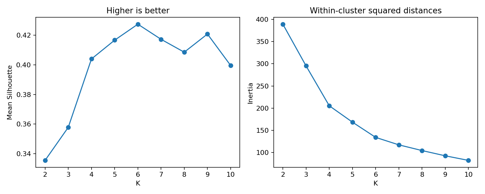

# Lab03 — Phân khúc khách hàng bằng K-Means

## 1. Mục tiêu

Nhóm các khách hàng tương đồng theo tuổi, thu nhập và điểm chi tiêu. Đây là học không giám sát. Cluster là nhãn nhóm do mô hình tạo, không phải nhãn đúng/sai có sẵn.

## 2. Dữ liệu

Mall_Customers.csv có 200 khách hàng, gồm CustomerID, Gender, Age, Annual Income (k$) và Spending Score (1-100). CustomerID dùng truy nguyên bản ghi. Gender giữ để xem dữ liệu gốc và chưa dùng làm đặc trưng. Nguồn phát hành và giấy phép chưa có metadata đi kèm CSV trong repository nên chưa xác minh được.

## 3. Khảo sát

Nguồn có 0 ô thiếu. EDA ghi thống kê mô tả, số giá trị thiếu, cờ ngoại lệ theo khoảng 1,5 IQR, histogram và boxplot. Cờ IQR là dấu hiệu kiểm tra, không tự động loại khách có thu nhập cao.

## 4. Tiền xử lý

Chọn đúng ba cột số theo YAML. Chuẩn hóa z = (x − trung bình)/độ lệch chuẩn với ddof=0. Cột hằng có mẫu số 1. Giá trị thiếu hoặc vô hạn và CustomerID trùng gây lỗi để người dùng kiểm tra. Bộ dữ liệu hiện tại vượt qua các kiểm tra đó. customers_scaled.csv giữ CustomerID cùng ba cột chuẩn hóa. scaling_parameters.csv lưu thống kê chuyển đổi.

## 5. Quy trình thực nghiệm

Phân cụm mô tả toàn bộ 200 khách hàng, nên fit và đánh giá cấu trúc cụm trên cùng dữ liệu. Không tách train/test. Silhouette trong bài này đo độ tách cụm nội bộ, chưa đo khả năng tổng quát tới khách hàng mới.

## 6. Thuật toán tự cài

KMeans trong algorithms/kmeans.py dùng NumPy. Khởi tạo k-means++, gán khách vào tâm gần nhất theo khoảng cách Euclid, cập nhật tâm bằng trung bình cụm. Cụm rỗng được đặt lại tại điểm đang xa tâm nhất. Dừng khi tổng độ dịch chuyển tâm theo chuẩn Frobenius không vượt tol hoặc đạt max_iter.

Mỗi K chạy n_init lần. Giữ lần có inertia nhỏ nhất. Seed cố định giúp tái lập. Inertia là tổng bình phương khoảng cách tới tâm. Sau bước cập nhật cuối, nhãn được gán lại từ các tâm đã lưu.

## 7. Chọn K

Thử K từ 2 đến 10. Silhouette được tự tính từ khoảng cách Euclid trên dữ liệu chuẩn hóa. Với mẫu i, a là khoảng cách trung bình đến các thành viên cùng cụm, b là khoảng cách trung bình nhỏ nhất tới cụm khác. Giá trị s = (b − a)/max(a,b). Cụm chỉ có một khách được gán 0.

Chọn Silhouette trung bình cao nhất, ưu tiên K nhỏ hơn nếu bằng điểm.

| k | silhouette | inertia | n_iter | converged |
| --- | --- | --- | --- | --- |
| 2 | 0.335 | 389.386 | 7 | True |
| 3 | 0.358 | 295.212 | 4 | True |
| 4 | 0.404 | 205.225 | 7 | True |
| 5 | 0.417 | 168.248 | 8 | True |
| 6 | 0.427 | 133.868 | 14 | True |
| 7 | 0.417 | 117.012 | 13 | True |
| 8 | 0.409 | 104.128 | 7 | True |
| 9 | 0.421 | 92.293 | 7 | True |
| 10 | 0.400 | 81.963 | 6 | True |

## 8. Kết quả và đặc điểm các phân khúc

Lần chạy 20261118T074359Z-36241066 chọn K=6, Silhouette khoảng 0,4274 và inertia khoảng 133,8683. Các đặc trưng mô tả dưới đây dùng đơn vị gốc.

| cluster | customer_count | Age_mean | Annual Income (k$)_mean | Spending Score (1-100)_mean |
| --- | --- | --- | --- | --- |
| 0 | 33 | 41.939 | 88.939 | 16.970 |
| 1 | 45 | 56.333 | 54.267 | 49.067 |
| 2 | 38 | 26.684 | 57.579 | 47.789 |
| 3 | 39 | 32.692 | 86.538 | 82.128 |
| 4 | 21 | 45.524 | 26.286 | 19.381 |
| 5 | 24 | 25.250 | 25.833 | 76.917 |

Các nhãn cụm chỉ là số định danh của lần chạy, có thể đổi thứ tự khi thay seed. Diễn giải dựa trên trung bình và số khách của từng cụm, cần kiểm tra thêm phân bố trước khi áp dụng chính sách kinh doanh.

## 9. Biểu đồ 3D

[Biểu đồ khách hàng 3D](../results/runs/20261118T074359Z-36241066/figures/customer_clusters_3d.html) dùng đơn vị gốc để dễ đọc. Màu là nhãn cụm, hover cho biết CustomerID. Khoảng cách được tối ưu trong không gian chuẩn hóa nên hình gốc có thể tạo cảm giác độ tách khác. HTML nhúng Plotly để mở ngoại tuyến.

## 10. Lưu và tái lập

Lần chạy lưu YAML, hash CSV, trạng thái, bảng K, nhãn từng khách, profile, tham số chuẩn hóa, hình và kmeans.joblib. Data/preprocessing là bản tiện truy cập của lần chạy thành công mới nhất. Các thư mục runs giữ kết quả theo phiên bản.

## 11. Giới hạn

Silhouette nhạy với lựa chọn đặc trưng và chuẩn hóa. K-Means thiên về các nhóm gọn theo khoảng cách Euclid. 200 khách chưa đủ để khẳng định đặc điểm thị trường rộng hơn. Chưa có kiểm tra độ ổn định nhiều seed ở cấp toàn bộ thí nghiệm, dù mỗi K có 20 khởi tạo.

## 12. Phạm vi đề bài

Triển khai phần phân cụm khách hàng theo cấu trúc được yêu cầu. PDF còn có bài bổ sung phân đoạn ảnh. Bài ảnh chưa được triển khai trong pipeline khách hàng này.
