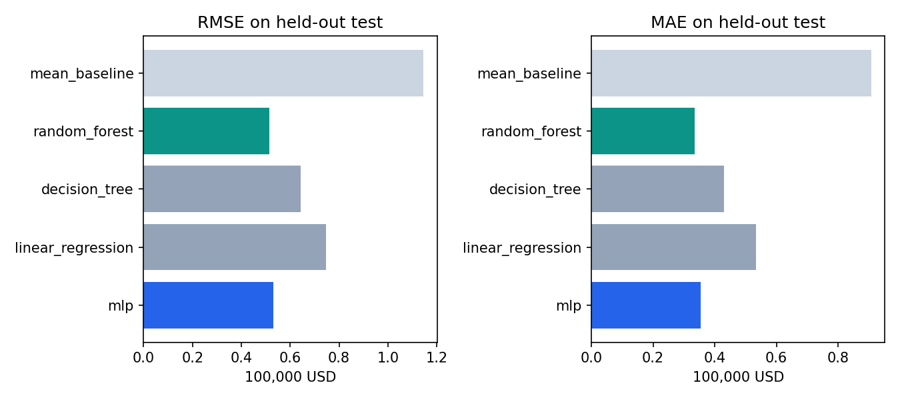

# Lab04 — Dự đoán giá nhà bằng PyTorch MLP

MLP dùng PyTorch; Linear Regression, Decision Tree và Random Forest dùng scikit-learn. Kiến trúc cơ sở: 8 → 32 → ReLU → 16 → ReLU → 1 tuyến tính. MSELoss, Adam, mini-batch và backpropagation được viết rõ trong src/train.py.

## Thành viên nhóm

- Vũ Thị Thanh Thùy
- Nguyễn Văn Minh
- Lê Hồng Sơn
- Phan Đình Hưng
- Phạm Minh Tiến
- Võ Thị Anh Tú

## Dữ liệu

Mặc định California Housing thay Boston trong đề cũ. Mỗi hàng là một census block group, không phải một căn nhà. Mục tiêu MedHouseVal là giá nhà trung vị, đơn vị 100.000 USD. Dữ liệu lịch sử, có giới hạn trên của target; không dùng để định giá nhà hiện tại. Nguồn và mô tả: https://scikit-learn.org/stable/datasets/real_world.html#california-housing-dataset

Lần đầu tự tải và lưu Data/raw/california_housing.csv; cache nằm trong Data/cache/. Có thể cung cấp CSV cùng schema qua --data. Không tự thay bằng dữ liệu giả nếu tải thất bại.

Tám đặc trưng theo thứ tự: MedInc (thu nhập trung vị, đơn vị 10.000 USD), HouseAge (tuổi nhà trung vị), AveRooms (phòng/hộ), AveBedrms (phòng ngủ/hộ), Population (dân số), AveOccup (người/hộ), Latitude, Longitude. Đặc trưng không tương đương trực tiếp diện tích/số phòng của một căn nhà.

## Chạy

Từ thư mục gốc dự án:

```powershell
python -m pip install -r Lab04/requirements.txt
python -m Lab04.src.pipeline
```

Kiểm tra nhanh (không dùng điểm này làm kết quả chính thức):

```powershell
python -m Lab04.src.pipeline --quick
```

## Luồng và kiến thức cần nắm

1. preprocessing.py: nạp CSV, kiểm tra hữu hạn, loại trùng, tạo row_id. Chia train/validation/test xấp xỉ 64/16/20%, seed 42/43. StandardScaler chỉ fit train.
2. model.py: nn.Module, Linear và ReLU; forward tạo một giá trị cho mỗi hàng.
3. train.py: zero_grad → forward → MSELoss → backward → Adam.step. Theo dõi MSE/MAE train/validation mỗi epoch; chọn checkpoint validation MSE thấp nhất, early stopping sau 15 epoch không cải thiện.
4. tuning.py: so sánh cấu hình theo validation MSE, giữ mô hình đã fit. Không dùng test để chọn cấu hình/epoch và không fit lại sau lựa chọn. Cấu hình nằm trong src/config.yaml.
5. pipeline.py: lưu mô hình, dùng cùng test để so sánh bốn thuật toán và mốc luôn đoán trung bình train.
6. evaluate.py/report.py: MSE, RMSE, MAE, R²; đường học, actual/predicted, residual và báo cáo. Report không huấn luyện lại.

Tất cả mô hình dùng cùng hàng dữ liệu và scaler; mô hình cây không cần chuẩn hóa nhưng có thể dùng chung đầu vào này. MAE/RMSE càng thấp càng tốt; R² có thể âm. MSE có đơn vị bình phương, không đọc trực tiếp như USD. Lựa chọn theo một seed và lưới nhỏ chưa chứng minh mô hình nào luôn tốt hơn; chia ngẫu nhiên không đánh giá khả năng dự đoán vùng địa lý/thời điểm mới.

## File đầu ra theo từng lần chạy

```text
Lab04/results/YYYYMMDD_HHMMSS_mlp_comparison/
├── run.json                 # Trạng thái, giờ Việt Nam, hash dữ liệu, phiên bản thư viện
├── events.jsonl             # Các giai đoạn
├── config.yaml              # Cấu hình thực tế
├── preprocessing/
│   ├── train.csv
│   ├── validation.csv
│   ├── test.csv
│   └── scaled.npz
├── models/
│   ├── mlp.pt               # state_dict và kiến trúc, không pickle toàn bộ mạng
│   ├── scaler.joblib
│   ├── schema.json
│   └── *.joblib             # Ba mô hình đối chiếu
├── evaluation/
│   ├── validation_metrics.csv
│   ├── selection.json
│   ├── mlp_history.csv      # Lịch sử ứng viên được chọn; checkpoint có thể ở epoch trước cuối
│   ├── mlp_candidate_*_history.csv
│   ├── metrics.csv          # Chỉ số test
│   └── *_predictions.csv    # row_id, giá thật, dự đoán
├── figures/
└── report.md
```

Nếu trùng giây, thêm hậu tố _02…; quick run có tên mlp_quick. Dữ liệu đầu vào/scaler không bị ghi đè bởi một lần chạy khác.

## Dự đoán CSV mới

CSV cần đủ tám cột đặc trưng, không cần target. Đổi RUN_ID và đường dẫn theo thực tế:

```powershell
python -m Lab04.src.predict --run-id RUN_ID --input new_houses.csv --output predictions.csv --model mlp
```

Mô hình và scaler được nạp từ đúng lần chạy; không fit lại. Không ghi đè tệp có sẵn. predict_csv() cũng được dùng để kiểm tra nạp lại mô hình. Các đầu ra chỉ phù hợp với schema và miền dữ liệu California Housing.

## Kiểm tra

```powershell
python -m unittest discover -s Lab04/tests -v
```


## Tài liệu chi tiết và hình minh họa

- [Báo cáo Lab04](docs/Lab04_Report.md) trình bày dữ liệu, luồng gọi hàm, nguyên lý MLP, chọn checkpoint, kết quả và phân tích sai số.
- [Giải thích tham số](docs/ReadmeForParameters.md) phân biệt cấu hình, tham số học được và các chỉ số.
- [Bố cục kết quả](docs/ResultsLayout.md) chỉ rõ nơi đọc từng loại đầu ra và nguồn hình.
- [Thư mục ảnh tài liệu](docs/images/) chứa tám hình của lượt đầy đủ `20261123_135712_mlp_comparison`.

MLP được chọn có kiến trúc 8 → 64 → ReLU → 32 → ReLU → 1, checkpoint epoch 79. RMSE test MLP là 0,52982 và Random Forest là 0,51493, theo đơn vị 100.000 USD.




minhh
