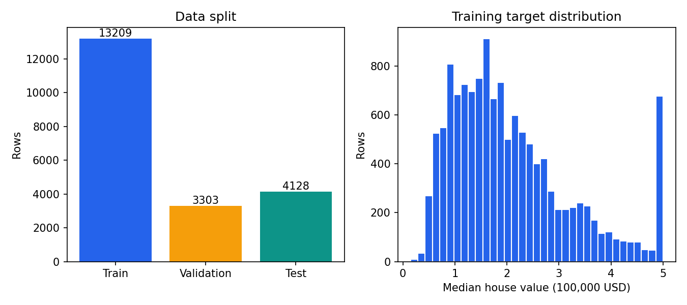
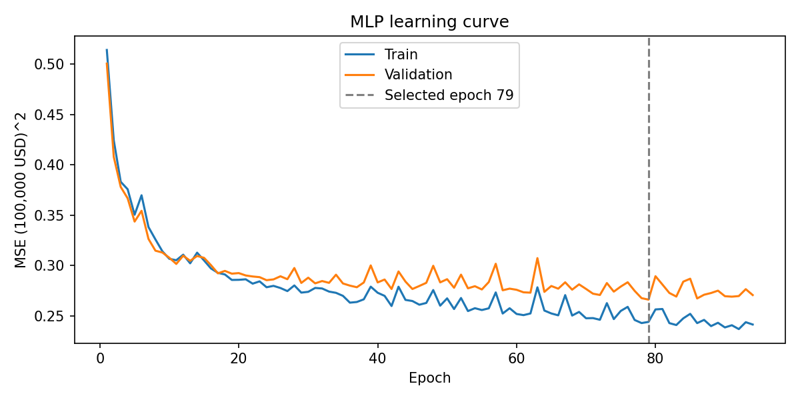
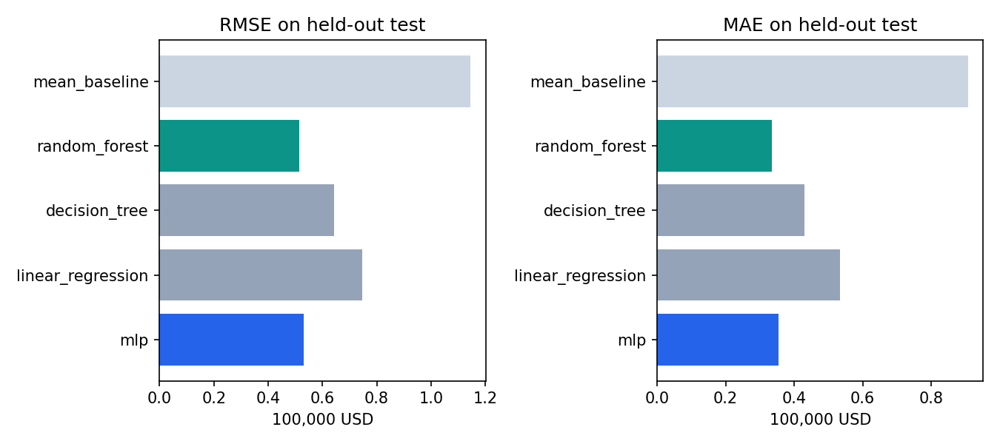
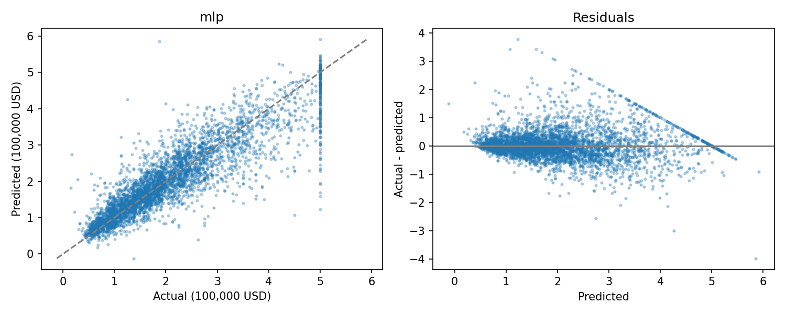
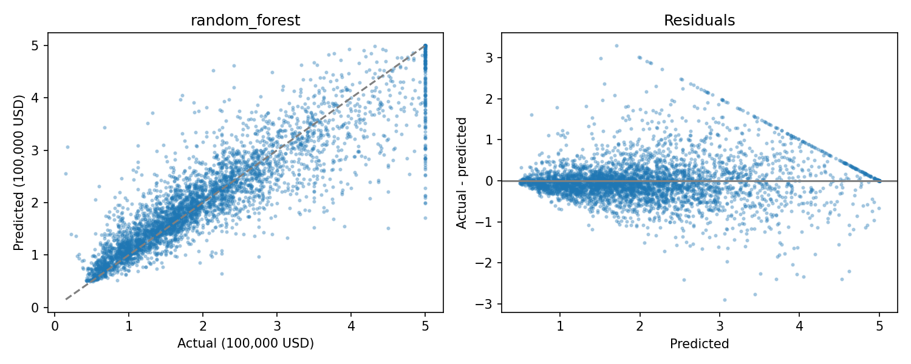
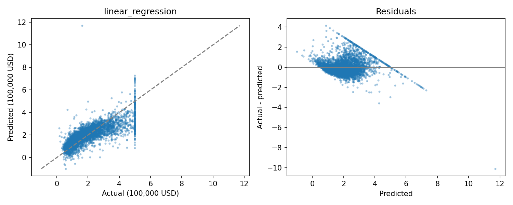
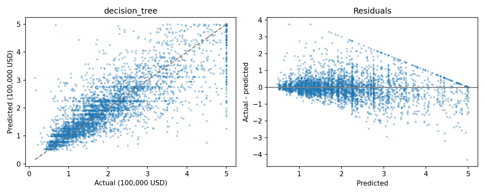
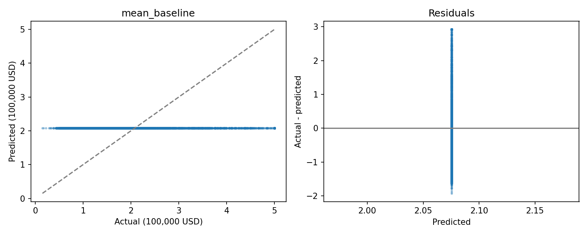

# Lab04 — Báo cáo dự đoán giá nhà bằng PyTorch MLP

## 1. Mục tiêu và phạm vi

Xây dựng mạng MLP để dự đoán giá nhà trung vị từ tám thuộc tính của một khu thống kê. So sánh MLP với Linear Regression, Decision Tree, Random Forest và một baseline luôn dự đoán trung bình train. Đây là bài toán hồi quy có giám sát, đầu ra là một số thực.

Báo cáo dùng lượt đầy đủ `20261123_135712_mlp_comparison`, hoàn tất ngày 23/11/2026. [Thông tin lượt chạy](../results/20261123_135712_mlp_comparison/run.json) lưu trạng thái success, phiên bản thư viện, hash dữ liệu và số mẫu. Thời gian toàn lượt khoảng 210 giây.

## 2. Dữ liệu và ý nghĩa đầu vào

California Housing có 20.640 hàng. Mỗi hàng mô tả một census block group. Target `MedHouseVal` có đơn vị 100.000 USD, ví dụ giá trị 2 tương ứng 200.000 USD của giá trung vị khu đó.

| Đặc trưng | Ý nghĩa |
|---|---|
| MedInc | Thu nhập trung vị, đơn vị 10.000 USD |
| HouseAge | Tuổi nhà trung vị |
| AveRooms | Số phòng trung bình trên hộ |
| AveBedrms | Số phòng ngủ trung bình trên hộ |
| Population | Dân số |
| AveOccup | Số người trung bình trên hộ |
| Latitude | Vĩ độ |
| Longitude | Kinh độ |

[Thông tin nguồn dữ liệu](../Data/raw/SOURCE.md). Dữ liệu lịch sử có target bị chặn trên. Các đặc trưng là thống kê theo khu, nên cần giữ đúng ý nghĩa khi nhập CSV demo.

## 3. Tiền xử lý và chia dữ liệu

`load_data()` đọc các cột bắt buộc, chuyển thành số, kiểm tra hữu hạn, gắn row_id và loại hàng trùng hoàn toàn. Đầu vào có cùng đặc trưng nhưng target khác nhau bị từ chối để xử lý trước khi chia. Lượt tham chiếu loại 0 hàng trùng.

`prepare()` giữ 20% làm test với seed 42. Phần 80% còn lại được chia tiếp, lấy 20% của phần này làm validation với seed 43. Tỷ lệ trên toàn bộ dữ liệu xấp xỉ 64/16/20.

| Tập | Số hàng | Vai trò |
|---|---:|---|
| Train | 13.209 | Học scaler và tham số mô hình |
| Validation | 3.303 | Chọn cấu hình, epoch và checkpoint |
| Test | 4.128 | Đánh giá cuối sau lựa chọn |

StandardScaler học trung bình và độ lệch chuẩn từ train. Validation, test và dữ liệu mới dùng lại scaler đó. Target giữ nguyên đơn vị ban đầu. Các mảng đầu vào được chuyển float32.



## 4. Cấu trúc và luồng gọi hàm

```text
pipeline.run_pipeline()
├── preprocessing.load_data()
├── preprocessing.prepare()
├── tuning.select_models()
│   ├── train.fit_mlp() → model.MLP
│   ├── LinearRegression.fit()
│   ├── DecisionTreeRegressor.fit()
│   └── RandomForestRegressor.fit()
├── evaluate.metrics() trên test
├── lưu mô hình, scaler, schema, dự đoán
└── report.generate() từ kết quả đã lưu

predict.predict_csv()
├── nạp run.json, schema và scaler của lượt đã hoàn tất
├── transform tám đặc trưng theo đúng thứ tự
├── nạp MLP state_dict hoặc mô hình joblib
└── predict() → kết quả theo đơn vị 100.000 USD và USD
```

[Mã điều phối](../src/pipeline.py), [huấn luyện](../src/train.py), [chọn cấu hình](../src/tuning.py) và [dự đoán](../src/predict.py) là các điểm đọc chính. Bộ so sánh dùng scikit-learn. MLP dùng PyTorch, với vòng cập nhật gradient viết trực tiếp.

## 5. Kiến trúc và nguyên lý MLP

Mỗi lớp Linear tính tổ hợp có trọng số và bias. ReLU biến các giá trị âm thành 0 để tạo quan hệ phi tuyến. Lớp cuối có một đầu ra tuyến tính cho hồi quy.

Cấu hình cơ sở là `8 → 32 → ReLU → 16 → ReLU → 1`. Cấu hình được chọn trong lượt tham chiếu là `8 → 64 → ReLU → 32 → ReLU → 1`, có 2.689 tham số học được.

Trong mỗi mini-batch, `fit_mlp()` thực hiện tuần tự:

1. `optimizer.zero_grad()` xóa gradient từ lần cập nhật trước.
2. `model(batch_X)` chạy forward để tạo dự đoán.
3. `MSELoss(predicted, batch_y)` tính trung bình bình phương sai số.
4. `loss.backward()` tính gradient theo trọng số và bias bằng backpropagation.
5. `optimizer.step()` dùng Adam cập nhật tham số.

Một epoch đi qua toàn bộ train theo các mini-batch được xáo trộn. Sau mỗi epoch, chương trình đánh giá lại trên toàn train và validation, ghi MSE/MAE. Validation dùng để đo chất lượng và chọn checkpoint.

## 6. Chọn cấu hình, early stopping và checkpoint

Hai kiến trúc MLP được thử với learning rate 0,001, tối đa 100 epoch, batch size 32 và patience 15. Mỗi epoch có validation MSE thấp hơn mọi epoch trước sẽ được sao lưu state_dict. Sau 15 epoch liên tiếp không cải thiện, vòng học dừng và nạp lại checkpoint tốt nhất.

Lượt tham chiếu chọn ứng viên 1, kiến trúc [64, 32], checkpoint epoch 79. Lịch sử ghi đến epoch 94. Tệp mô hình lưu trọng số epoch 79 sau khi phục hồi checkpoint. Vì vậy hàng cuối của lịch sử không đại diện trực tiếp cho trọng số đã lưu.



Các mô hình đối chiếu được chọn bằng validation MSE thấp nhất. Decision Tree chọn độ sâu 12, ít nhất 5 mẫu/lá. Random Forest chọn 100 cây, độ sâu không giới hạn và ít nhất 2 mẫu/lá. Linear Regression có một cấu hình mặc định.

Các đối tượng đã fit được giữ lại sau lựa chọn. Tập train và validation vẫn giữ vai trò riêng trong lượt này, manifest ghi `refit=false`. [Cấu hình đã chọn](../results/20261123_135712_mlp_comparison/evaluation/selection.json).

## 7. Kết quả test

| Mô hình | MSE | RMSE | MAE | R² |
|---|---:|---:|---:|---:|
| mlp | 0.28071 | 0.52982 | 0.35474 | 0.78578 |
| linear_regression | 0.55700 | 0.74633 | 0.53419 | 0.57494 |
| decision_tree | 0.41501 | 0.64421 | 0.42920 | 0.68330 |
| random_forest | 0.26515 | 0.51493 | 0.33562 | 0.79766 |
| mean_baseline | 1.31082 | 1.14491 | 0.90674 | -0.00031 |

MAE là trung bình độ lớn sai số. RMSE phạt mạnh các sai số lớn. Hai chỉ số có đơn vị 100.000 USD và càng thấp càng tốt. MSE có đơn vị bình phương. R² so sánh sai số với mốc trung bình của target trong tập được đánh giá, có thể âm.



Random Forest đạt RMSE thấp nhất trong lượt này, khoảng 51.493 USD. MLP đạt khoảng 52.982 USD, thấp hơn Linear Regression, Decision Tree và mean baseline. RMSE MLP cao hơn Random Forest khoảng 2,89%. MAE MLP khoảng 35.474 USD, còn Random Forest khoảng 33.562 USD.

Baseline lấy trung bình target train để dự đoán mọi mẫu test. R² của baseline gần 0 và hơi âm vì trung bình train khác trung bình test. Các con số là kết quả của một lần chia và một lưới cấu hình nhỏ.

Nguồn số liệu là [metrics.csv](../results/20261123_135712_mlp_comparison/evaluation/metrics.csv). Kết quả test được đọc sau khi chốt lựa chọn bằng validation.

## 8. Đọc biểu đồ dự đoán và phần dư

Trong hình trái, mỗi điểm biểu diễn giá thật và giá dự đoán. Điểm gần đường chéo thể hiện sai số nhỏ. Hình phải dùng phần dư bằng thực tế trừ dự đoán. Phần dư dương nghĩa là dự đoán thấp, phần dư âm nghĩa là dự đoán cao.

Ví dụ, thực tế 3 và dự đoán 2,5 tạo phần dư 0,5, tương ứng dự đoán thấp hơn 50.000 USD. Có thể dùng row_id trong CSV dự đoán để đối chiếu lại mẫu.











## 9. Lưu mô hình và dự đoán lại

`models/mlp.pt` chứa state_dict, input_dim và kích thước các lớp ẩn. Ba mô hình đối chiếu nằm trong joblib. Scaler và schema được lưu cùng lượt chạy để giữ đúng thứ tự và cách xử lý đầu vào. MLP.predict() dùng chế độ eval và tắt tính gradient.

Chạy từ thư mục gốc repository, với CSV có đủ tám cột đặc trưng:

```powershell
python -m Lab04.src.predict --run-id 20261123_135712_mlp_comparison --input new_houses.csv --output predictions.csv --model mlp
```

Tệp đầu ra có `prediction_100000_usd`, `prediction_usd` và run_id. Tệp output phải là đường dẫn mới. Các giá trị dự đoán là đầu ra hồi quy liên tục.

## 10. Giới hạn và khả năng tái lập

Chia ngẫu nhiên có thể đặt các khu gần nhau vào nhiều tập, nên điểm test hiện tại đo khả năng tổng quát theo cách chia đó. Muốn đánh giá vùng mới cần chia theo vùng địa lý. Target bị giới hạn trên có thể ảnh hưởng việc diễn giải sai số ở nhóm giá cao. Một seed và lưới nhỏ chưa đủ kết luận thứ hạng ổn định.

Lượt tham chiếu chạy Python 3.13.9, torch 2.6.0+cpu và scikit-learn 1.7.2. Seed, cấu hình thực tế, hash dữ liệu và phiên bản được lưu trong run.json và config.yaml của lượt. Điểm số có thể khác khi môi trường hoặc dữ liệu thay đổi.

```powershell
python -m Lab04.src.pipeline
python -m unittest discover -s Lab04/tests -v
```

Chế độ `--quick` giới hạn MLP còn 5 epoch để kiểm tra quy trình. Báo cáo này lấy số liệu từ lượt đầy đủ.

## 11. Tra cứu tài liệu và kết quả

- [Giải thích tham số](ReadmeForParameters.md)
- [Bố cục đầu ra và nguồn ảnh](ResultsLayout.md)
- [Hướng dẫn chạy](../README.md)
- [Báo cáo tự động của lượt tham chiếu](../results/20261123_135712_mlp_comparison/report.md)
